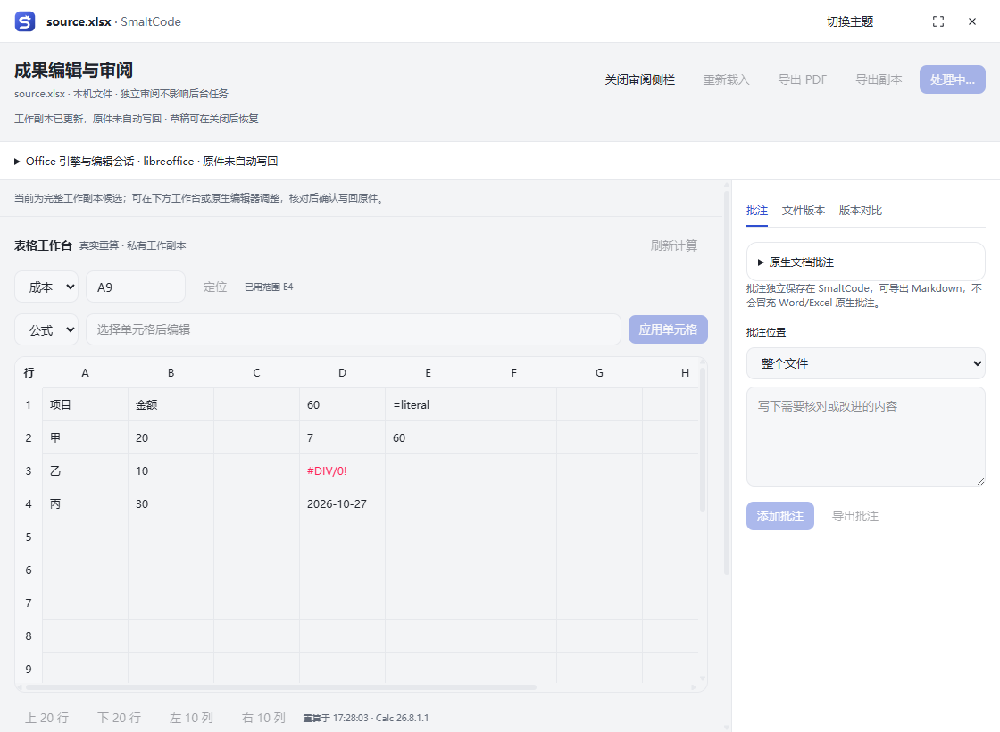
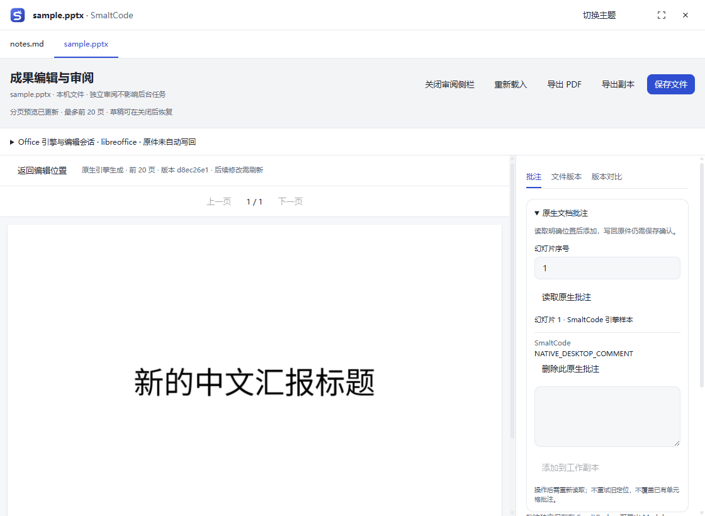
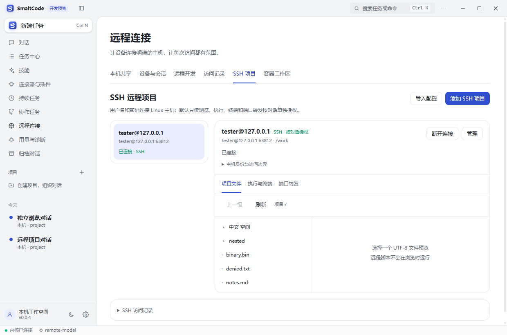
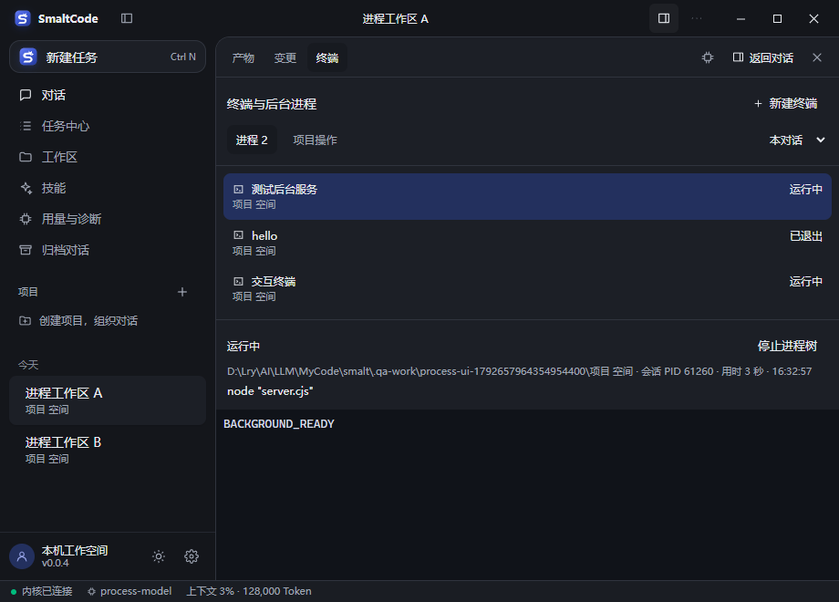

# SmaltCode

<div align="center">
  <picture>
    <source media="(prefers-color-scheme: dark)" srcset="docs/brand/smaltcode-wordmark-dark.svg" />
    
  </picture>
  <p><strong>从一句需求，到看得见、可核对的工作成果。</strong></p>
  <p>多模型 AI 编程与办公桌面助手 · 中文界面 · 本地保存 · 可控执行</p>
  <p>
    
    
    
  </p>
  <p><a href="https://github.com/lryoooow/SmaltCode/releases/tag/v0.0.5">下载安装</a> · <a href="#快速开始">快速开始</a> · <a href="docs/releases/v0.0.5.md">本次更新</a> · <a href="https://github.com/lryoooow/SmaltCode/issues">反馈与建议</a></p>
</div>

> **0.0.5 是公开测试版本。** 欢迎体验、报告 Bug、提出交互与功能建议，也欢迎参与代码和文档改进。Office、远程主机及第三方模型的兼容性仍需更多真实场景验证。


## 目录

- [它能做什么](#它能做什么)
- [界面一览](#界面一览)
- [下载与安装](#下载与安装)
- [快速开始](#快速开始)
- [本次更新](#本次更新)
- [权限与数据](#权限与数据)
- [测试版的边界](#测试版的边界)
- [开发与验证](#开发与验证)
- [参与建设](#参与建设)

## 它能做什么

SmaltCode 将对话、代码执行、文档编辑、终端和任务管理放在同一个桌面工作区。你可以直接开始聊天；需要资料、项目目录或远程环境时，再明确添加。

| 场景 | 当前能力 |
| --- | --- |
| 日常对话与项目 | 不选目录即可对话；项目归类、共享说明、只读资料、对话搜索定位、归档和删除 |
| 编程与执行 | 文件修改与差异、计划与节点进度、交互式终端、后台进程、多会话管理、项目常用操作 |
| 长任务与协作 | 持续/定时任务、停止条件、记忆与模板；并行子任务、独立 worktree、结果汇总和合并审查 |
| 文档与成果 | PDF/Word/Excel 预览、选段引用、独立审阅窗、多文档标签、草稿、版本比较与保存确认 |
| Office 工作台 | LibreOffice 驱动的 Calc 网格、公式重算与结构编辑；Impress 幻灯片、对象、备注和 PDF；Writer 选段、修订与分页审阅 |
| 远程开发 | SSH 用户名/密码、私钥或本机 agent；指纹核验、只读项目、按对话授权的终端/执行/回环转发 |
| 容器 | 本机 Linux 容器、受限 Dev Containers、配置审查、手动生命周期节点和 SSH 容器目标 |
| 外部工具 | 隔离浏览、MCP 服务连接、工具发现、认证与插件权限管理 |
| 跨设备 | 显式开启的 HTTPS 主机连接、配对、设备/会话撤销和手机查看/回答 |
| 多模型 | 服务商模型发现、搜索和容量来源提示；上下文整理、错误检查与用量诊断 |

内置 DeepSeek、智谱、Kimi、通义千问、OpenAI、Anthropic、OpenRouter 和 Ollama 配置。支持 OpenAI 兼容 Chat Completions 与 Anthropic Messages；实际可用性取决于服务地址、账户权限和模型的工具调用能力。

## 界面一览

<table>
  <tr>
    <td width="50%"><p align="center">表格编辑与真实公式计算</p></td>
    <td width="50%"><p align="center">演示文稿与分页审阅</p></td>
  </tr>
  <tr>
    <td width="50%"><p align="center">SSH 项目与按对话授权</p></td>
    <td width="50%"><p align="center">后台任务与进程管理</p></td>
  </tr>
</table>

截图来自真实桌面验收，使用隔离测试资料和本机模拟模型。部分画面保留开发预览版本标记；发行包的版本及图标单独验证。

## 下载与安装

**Windows x64 · v0.0.5 公开测试版 · S Fox 统一图标**

1. 下载 [SmaltCode-Setup-0.0.5-SFox.exe](https://github.com/lryoooow/SmaltCode/releases/download/v0.0.5/SmaltCode-Setup-0.0.5-SFox.exe)。
2. 升级前从系统托盘退出旧版，并备份已有工作资料；按向导选择安装目录。
3. 从桌面或开始菜单打开 **SmaltCode**，配置模型即可开始对话。

[Release 与更新说明](https://github.com/lryoooow/SmaltCode/releases/tag/v0.0.5) 同时提供 [SHA256SUMS.txt](https://github.com/lryoooow/SmaltCode/releases/download/v0.0.5/SHA256SUMS.txt)。在 PowerShell 中核对：

```powershell
Get-FileHash .\SmaltCode-Setup-0.0.5-SFox.exe -Algorithm SHA256
```

当前安装包未做代码签名，Windows 可能显示未验证发布者。macOS、Linux 暂未提供经过桌面验收的安装包。

## 快速开始

### 1. 配置模型

打开 **设置 → 模型服务商**，填写自己的 API Key 和服务地址，刷新模型列表，再保存并测试连接。软件会显示可获得的模型目录与上下文规格来源；第三方接口未返回的信息可手动填写。

### 2. 直接对话，按需添加资料

新建对话即可输入任务，无需先选择项目或目录。文件默认保存在独立本地空间，具体位置可在 **资料与产物** 中查看。

- **项目**：组织对话，共享项目说明与资料；可以设置可选的工作目录。
- **资料**：主动添加供阅读和引用的文件/文件夹；添加资料不会改变执行目录。
- **执行环境**：需要处理现有代码或文件时，再明确授权可修改的目录，或绑定 SSH/容器。
- **产物**：查找生成文件、预览和另存副本；修改原文件仍按对应目录和保存授权处理。

### 3. 查看过程，核对成果

一个任务状态区展示当前动作和节点进度，详细思考与执行记录按需展开。执行期间可以上翻历史、浏览文件、切换对话；选择“查看最新”恢复跟随。失败原因与处理入口直接展示，并保留原始记录。

文档预览中的 **独立编辑与批注** 打开审阅窗。同一对话可保留最多 8 个文档标签，切换前持久化草稿。Office 工作台需要可信的本机 LibreOffice；在 **Office 引擎与编辑会话** 中选择组件，文件先编辑私有副本，再明确点击 **保存文件** 写回原件。

### 4. 按需连接 SSH 或扩展工具

进入 **远程连接 → SSH 项目 → 添加 SSH 项目**，按字段填写主机、端口、**用户名、密码**和远程项目路径。核验主机指纹后可只读浏览；需要执行时，再把该连接绑定到对话并授权。密码和私钥通过认证界面填写。

MCP、插件、持续任务、协作任务和容器均有独立入口。先检查来源、目标和权限，再按具体任务启用。

## 本次更新

**0.0.5 将阶段 1–17 已完成的预览能力集中发布**，重点包括：

- 搜索定位、错误与上下文检查、待处理说明队列，及统一侧栏/浮层和结果展示。
- 后台进程、交互式终端、多会话管理、MCP/插件、持续任务和并行协作。
- 远程设备与会话、SSH 认证/终端/执行/受控转发、本机容器和受限 Dev Containers。
- Office 编辑会话、保存确认、崩溃恢复、Calc/Impress/Writer 工作流，以及多文档审阅。
- 项目、资料、执行环境和产物分离，保留不选目录也能直接对话。
- 修复 SSH 错误密码重试与迟到认证响应、Office 最终关闭收取、退出并发和恢复清理。
- 修复安装后外部 Office 脚本/SSH 解密线程路径，补充打包运行时验收。

详见 [0.0.5 Release 说明](docs/releases/v0.0.5.md)、[发布验收记录](docs/releases/v0.0.5-verification.json)。历史版本：[0.0.4](docs/releases/v0.0.4.md) · [0.0.3](docs/releases/v0.0.3.md) · [0.0.2](docs/releases/v0.0.2.md) · [0.0.1](docs/releases/v0.0.1.md)。

## 权限与数据

- 对话、项目、配置、草稿和工作副本保存在本机。模型 API 会收到当前任务所需上下文；跨设备共享范围由用户明确配置。
- 运行中可调整权限，按一次、操作组或本对话同类操作授权，并可撤销附加许可。
- 外部网页、MCP 返回和远程文件作为不可信资料处理；读取资料不等于获准执行其中指令。
- Office 使用私有副本、版本检查与明确保存确认；冲突、断线或未确认的操作不会自动重放。
- 关闭窗口会驻留托盘，后台任务继续；右键托盘 **退出 SmaltCode** 才会完全退出。清理未确认时保留驻留并显示原因。

## 测试版的边界

| 能力 | 需要了解 |
| --- | --- |
| Office | 不随包安装 LibreOffice，不修改默认文件关联。复杂排版、任意图表、动画/音视频和所有文档保真并未全部覆盖；复杂对象可使用可信原生编辑器 |
| SSH | 受管执行面向符合能力要求的 Linux 主机；跳板机、远端 Windows 和硬件认证等扩展待后续完善 |
| 容器 | 当前以 Windows Docker Desktop / Linux 容器验收；受限 Dev Containers 不等于完整多服务编排或生产部署平台 |
| 持续/定时任务 | 依赖应用运行，受停止条件、预算和权限约束；没有脱离应用的云端调度服务 |
| 本机执行 | 目录授权属于应用控制，原生 Office、终端及外部工具具有当前用户的系统权限 |
| 兼容性 | 本地模拟模型与真实协议/引擎回归通过，不代表所有服务商、服务器或 Office 文档均已验证 |

## 开发与验证

需要 Node.js 22+、npm 和 Windows 本地构建环境。

```bash
npm ci
npm run typecheck
npm run build
npm test
npm run preview:desktop
```

独立源码预览使用 `.local-preview/`，与正式版资料隔离。生成安装包：

```bash
npm run package:desktop
```

打包流水线验证版本与全部图标、ASAR 文件一致性、文档解析、原生 PTY/SSH 工作线程、启动和托盘退出。设置 `SMALT_TEST_OFFICE_LIBRE` 与 `SMALT_TEST_OFFICE_PYTHON` 后，还会验证打包目录下真实 Office 保存链；组件需自行准备。

**本仓库保持 GitHub Actions 关闭**，验证在本地完成。测试范围和实际结果见 [发布验收记录](docs/releases/v0.0.5-verification.json) 及各版本 Release。

```text
packages/kernel/   智能体、模型、工具、权限和任务存储
packages/desktop/  桌面界面、进程、远程连接和文档工作台
packages/cli/      命令行入口
scripts/           本地构建、打包和桌面验收
docs/              使用说明、设计记录和验证资料
```

## 参与建设

欢迎在 [Issues](https://github.com/lryoooow/SmaltCode/issues) 提交 Bug 和建议，附上版本、复现步骤、预期/实际结果及脱敏截图。涉及模型或远程连接时，请说明服务类型与错误信息，并去除密钥、密码和私有资料。

开发贡献见 [CONTRIBUTING.md](CONTRIBUTING.md)。欢迎帮助改善中文交互、模型适配、Office 兼容与真实环境测试。

## 开源协议与致谢

采用 [Apache-2.0](LICENSE)；第三方组件及许可见 [NOTICE](NOTICE)。感谢社区提供反馈、问题复现和改进建议。
