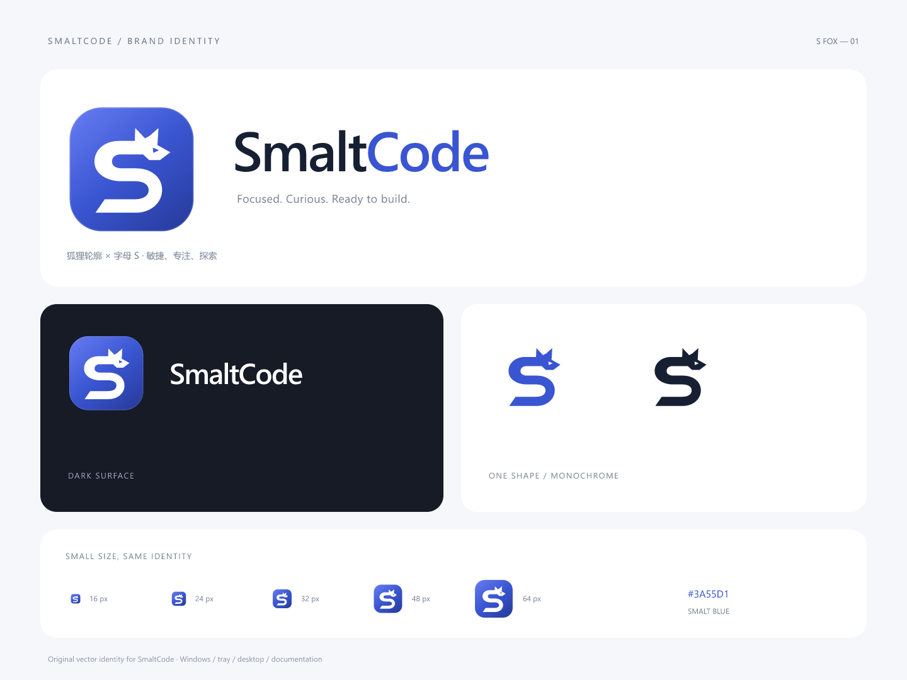

# SmaltCode · S Fox

狐狸的耳朵与侧脸融入字母 S，弯曲的身体和收尖的尾部共同形成完整符号。保留 SmaltCode 的品牌蓝，让动物与名称形成一个容易识别的整体。

## 资源

| 文件 | 用途 |
| --- | --- |
| ../../packages/desktop/assets/smalt.svg | 应用图标唯一矢量母版，不依赖字体 |
| smaltcode-icon-1024.png | 1024 像素透明边缘图标 |
| smaltcode-wordmark-light.svg / .png | 浅色背景的图形与名称组合 |
| smaltcode-wordmark-dark.svg / .png | 深色背景的图形与名称组合 |
| smaltcode-mark-blue.svg | 透明背景的蓝色动物符号 |
| smaltcode-mark-white.svg | 透明背景的白色动物符号 |
| smaltcode-identity.png / .svg | 完整品牌展示与小尺寸预览 |

## 使用约定

- 名称固定为 SmaltCode，保持大小写。
- 桌面、托盘、窗口和安装程序使用同一个图形；图标中不放小字。
- 主题变化使用相应字标或单色符号，保持狐狸轮廓和 S 形关系，不拉伸、不增添细节。
- 16、24、32、48、64、128、256 像素 ICO 由母版生成，不另画一套托盘图形。
- 主色为 #3A55D1，图形使用平缓的蓝色渐变；黑白印刷使用单色符号。
- 正文界面不额外添加动物插画或装饰，保持工作区清爽。

## 重新生成

    node scripts/create-app-icon.mjs
    node scripts/render-brand.mjs
    npm run package:desktop

字标 SVG 保留可编辑文字，建议使用 Segoe UI；PNG 导出可直接用于文档，无需安装字体。应用图标本身全部由路径组成，不受字体影响。应用、安装程序和文档均从同一矢量母版导出。

## 安装包文件图标核对

0.0.2 已核对 EXE 主图标和全部图标组，各尺寸均来自狐狸矢量母版。额外使用 Windows Shell 实际读取了 16 和 32 像素的安装包文件图标，均显示新狐狸图标。

当前公开安装包为 **SmaltCode-Setup-0.0.3-SFox.exe**，版本为 **0.0.3**。沿用同一狐狸矢量母版，核对全部图标组与 PE 版本；[0.0.3 校验结果](../releases/v0.0.3-verification.json) 保留发布证据，0.0.2 记录作为历史保留。
