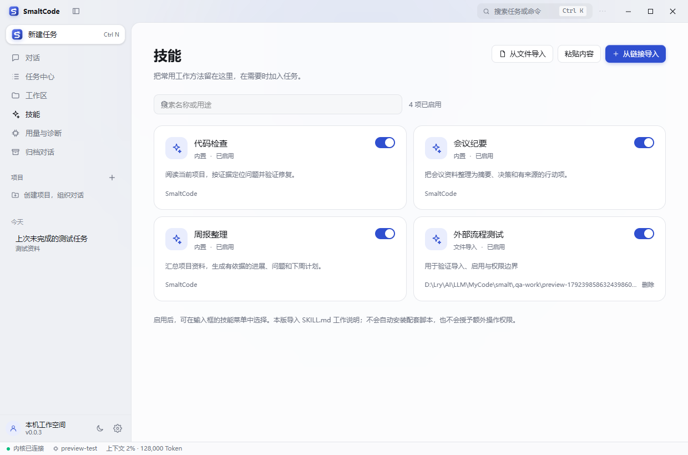
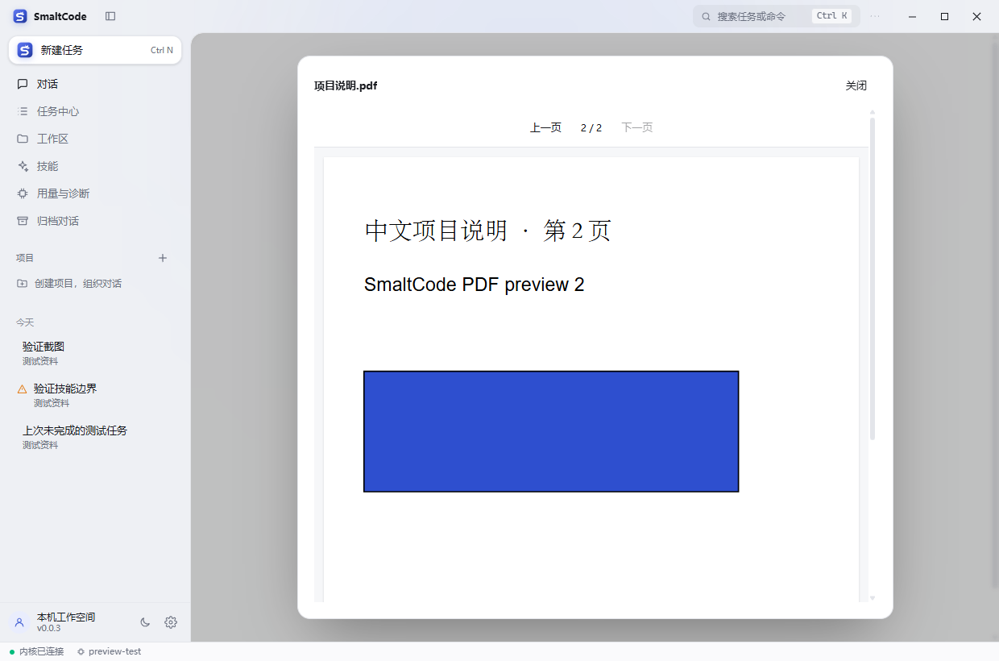
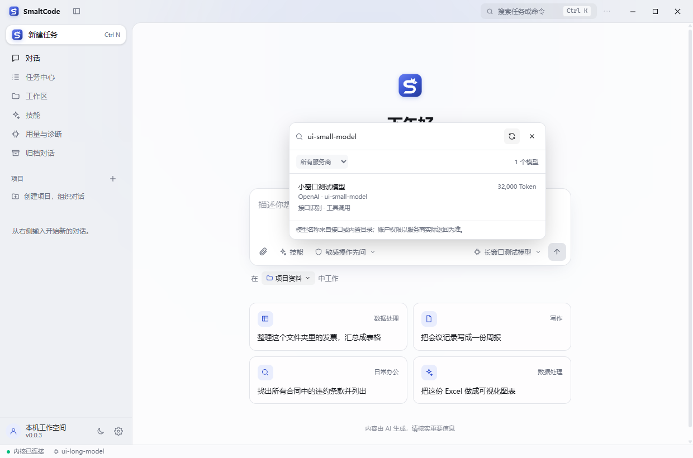
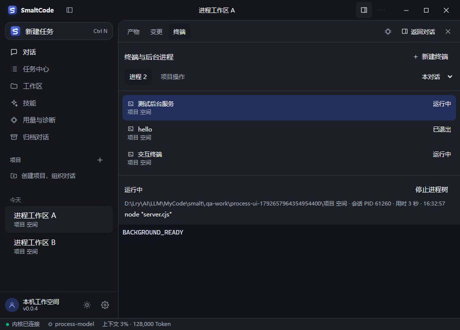

# SmaltCode 0.0.5：功能细节与本地验收

0.0.5 公开测试版集中交付此前阶段 1–17 的本轮能力，以及文件工作流、SSH、Office、多标签和退出清理修复。[发行说明](releases/v0.0.5.md) · [下载 Release](https://github.com/lryoooow/SmaltCode/releases/tag/v0.0.5) · [发布验收](releases/v0.0.5-verification.json)。GitHub Actions 保持关闭。

普通对话无需先选择项目或文件夹，使用独立本地空间；项目用于归类与共享说明/资料，执行环境按需授权。资料、产物与执行环境由统一文件面板管理。详见 [文件工作流](file-context-implementation-2026-10-27.md)、[SSH 使用](ssh-execution.md)、[Office 与多文档](office-phases-sixteen-seventeen-2026-10-27.md) 和 [最新专项复查](quality-recheck-2026-10-28.md)。

下文保留各阶段当时的范围与原始验证记录；其中“仅源码预览”“暂未打包”是该次开发记录的历史状态。本次已发布范围与边界以 0.0.5 Release 为准。

## 启动独立开发预览

Windows 双击仓库根目录的 `打开开发预览.cmd`，或执行：

```bash
npm run preview:desktop
```

入口先构建源码，再打开带有“开发预览”标记的桌面窗口。需要已安装本仓库的 Node.js/npm 开发依赖。已构建时可直接执行 `node scripts/start-desktop-preview.mjs --no-build`。

预览配置、密钥、对话、技能和附件独立保存在仓库的 `.local-preview/data/`；此目录已加入 Git 忽略规则。**首次使用需自行配置模型**，不会复制正式版的密钥或对话。两者可以并存，预览也支持关闭窗口驻留托盘、托盘右键完全退出。

## 本批次完成内容

| 能力 | 使用入口与行为 |
| --- | --- |
| 技能库 | 侧栏“技能”，内置代码检查、会议纪要、周报整理；支持搜索、查看、启停和删除外部技能 |
| 外部技能导入 | 公开 HTTPS/GitHub 文件链接、本地 SKILL.md、粘贴文本；先预览来源与内容，确认后保持停用 |
| 为消息选择技能 | 输入框“技能”，只显示已启用项；每条消息最多选择 3 项，并显示引用标签 |
| 图片上下文 | 文件选择或粘贴 PNG/JPEG 截图，先预览再发送；以真实图片消息送给模型 |
| 资料预览 | PDF 原页绘制与翻页、DOCX 正文、XLSX 工作表和单元格；沿用文本文件多标签工作台 |
| 文档选段引用 | 任务右侧预览中点“选择文本”，选中提取文字后加入当前消息；提示模型分析或给出改写，不用文本补丁覆盖二进制原件 |
| 阅读位置 | PDF 页码、Excel 工作表及文件滚动位置按对话保留；切换页面或对话不停止后台任务 |
| 用量与诊断 | 侧栏集中查看已记录的输入/输出 Token、各对话用量、待恢复任务、本机运行文件与解析器状态 |
| 中断恢复 | 启动时识别未正常结束的任务，明确标记未保存的工具结果；用户检查后主动继续，不自动重放命令 |
| 执行验收 | 命令可使用独立程序与参数，保留真实退出码；检查发现、执行故障、跳过与结果冲突分别记录，重开后仍可查看 |
| 模型目录 | 设置与输入框共用搜索列表，支持筛选、刷新、接口容量、官方规格、手动覆盖及停用型号提示 |
| 诊断导出 | 通过保存对话框导出版本、运行文件状态与数量摘要，不包含正文、文件内容、服务地址和密钥 |





截图来自隔离测试配置和模拟模型服务。

## 外部内容的处理边界

导入器只保存 **SKILL.md 工作说明**。不会运行配套脚本、安装依赖或更改权限；引用 `scripts/`、`references/`、`assets/` 的技能会提示资源未随之导入。启用后，还需在输入框中明确选择，才会随消息发送给所选模型。

网络读取仅支持公开 HTTPS 443，不携带系统 Cookie 或认证信息。DNS 地址、每次重定向都重新校验，连接固定到已检查的地址；拒绝私网、本机及保留地址，最多 3 次重定向、64 KB、15 秒。导入预览 10 分钟后失效，确认保存的是已预览的同一份内容。

**当前网络验收限制：** 本机访问 `raw.githubusercontent.com` 时 DNS 返回保留地址，公开 GitHub 下载验收因此被阻止，未宣称真实外网导入通过。若代理使用 Fake-IP，切换到返回真实公网地址的 DNS 模式后再测；也可先下载 SKILL.md，通过“从文件导入”使用。不会为了下载而放开私网保护。下载与重定向的正常/异常行为已用可控网络测试覆盖。

Office 解压、XML、图片尺寸和文档文字都有上限；解析运行在受限工作线程，避免损坏文件卡住界面。不执行 Office 公式、宏、外部关系、PDF 表单或脚本。技能和文档内容按外部资料传给模型，继续沿用现有审批与工作区保护。**现有命令工具仍以用户身份运行，应用权限控制不等同于操作系统沙箱。**

## 此前公开安装版的支持范围（历史记录）

| 项目 | 范围 |
| --- | --- |
| 图片 | PNG/JPEG；单张 8 MB、4000 万像素；每条消息最多 4 张，需所选模型支持图片理解 |
| 文件 | 单个 15 MB；只读解析 PDF、DOCX、XLSX 和 UTF-8 文本，不包含旧版 DOC/XLS |
| Word | 正文与基础标题，不还原完整分页、复杂表格布局、批注或修订 |
| Excel | 已保存值与缓存公式结果；最多 10 表、每表前 1000 行/50 列，合计 30000 单元格/200000 字符；保留空白行位置 |
| PDF | 原页预览；文字提取最多 100 页/200000 字符；不含 OCR，加密文件需先解密 |
| 消息引用 | 每条消息最多 10 项；完整文档上下文取前 24000 字符，也可选段；超限明确提示 |
| 本地附件副本 | 持久保存用户明确添加的文件，256 MB/1000 项；本批次暂未提供容量清理界面 |
| 技能格式 | 常用 name/description frontmatter；正文 64 KB，单次选中正文合计 36000 字符；不支持整个插件包安装 |
| 用量 | 模型返回且已记录的累计 Token，包含归档对话，删除的对话不在统计内；不推算费用，压缩等未记录请求可能缺失 |

上表保留此前公开安装版的范围。MCP、持续目标、定时任务、记忆及受控成果编辑已在后续源码阶段实现，见本文第五至九阶段；SSH、容器和完整 Office 编辑的未完成部分见剩余能力计划。

## 执行可靠性与验证记录

只读审查可以正常结束并报告项目问题：`ruff format --check` 发现文件需要格式化属于检查发现；测试断言失败属于项目验证未通过；命令不存在、启动失败和超时属于执行故障。输出报告失败但外层命令返回 0，或检查被跳过时，显示“待验证”。原始输出与退出码保持可查。

测试和构建优先使用 `shell` 的 `program`、`args` 与工作区内 `cwd` 参数，避免拼接终端命令覆盖检查的退出码。Windows 批处理包装器只接受可安全引用的参数；复杂内联脚本应使用原生 Node/Python 程序。独立执行不会绕过既有权限、高风险检查与目录限制。

相同回合、相同范围的可靠复查可关联旧尝试；整套测试失败不会被单个用例通过清除。缺少终端搜索命令时，可关联已成功执行的原生搜索工具。权限拒绝、不同目录或不同检查范围不会由这些关联自动清除。无法可靠确认的复杂命令仍保留待验证状态。

模型准备结束时，系统检查未完成计划、可恢复的调用错误、冲突结果，以及代码改动缺少验证记录等情况，最多补充一次验收提醒。仍未验证的事项会如实保留；不会为了让检查变绿而修改只读审查中的文件，也不重复请求已拒绝的操作。该记录依据实际工具证据，不能代替所有业务场景的验收。

本地回归：402 项通过，3 项 CLI SEA 专用检查跳过；类型检查与构建通过。实际 Electron 界面使用隔离资料和模拟服务商，113 次推理请求及 5 次模型目录请求；技能/附件/文档验收另 7 次推理请求，均无渲染错误。检查结果分类、退出码冲突、跳过覆盖、重试关联、滚动切换和重开恢复均包含在验收中。

真实服务商评估独立于默认测试：`node scripts/eval-task-reliability.mjs --live [--provider NAME]` 仅发送合成样例，最多 8 次请求、每次 4096 输出 Token、180 秒。本次隔离环境未取得可用凭据，预检停止，未发送真实模型请求；不将模拟验收计为真实服务商兼容性通过。不要把密钥写入代码或提交到仓库。

本地安装包位于 `packages/desktop/release/SmaltCode-Setup-0.0.3-SFox.exe`，SHA256 见同目录 `SHA256SUMS.txt`。桌面构建直接打包当前内核源码，避免引用旧的内核编译目录；产物需通过图标、文件一致性、文档解析、启动及托盘退出重开检查。覆盖安装前先通过托盘退出旧版，安装与真实模型长任务由维护者继续验收。

## 统一任务进度与模型上下文容量

输入框上方只保留一个任务卡，显示实际运行的动作、程序或文件、已完成节点与计划入口。“思考与执行记录”只展示可展开的明细，不再重复转圈或展示另一组进度。计划在任务卡上方展开为非模态浮层；支持 Escape、点击外侧关闭、键盘滚动、长文本换行，浏览或切换对话不会停止任务。历史回合只保留最终计划快照，独立于执行记录；停止或失败时保留实际完成比例，不伪装成全部完成。新日志持久化计划 ID，旧日志用回合与事件序号生成稳定 ID，避免同毫秒更新相互覆盖。

旧逻辑将不同型号统一套用服务商的 128K 默认容量，叠加系统与工具开销后导致长窗口模型约 100K 就整理。0.0.3 按确切端点和型号解析预算；DeepSeek V4 Pro 的 1M 容量依据：[官方模型说明](https://api-docs.deepseek.com/quick_start/pricing/)。

- 官方 DeepSeek V4 Pro / Flash 按具体模型解析为 1000000 Token，默认约 800000 Token 时整理；不会在 10K、100K 或 256K 时主动压缩。官方规格只应用于确切官方端点和已确认的模型名。
- 第三方网关先读取自身接口报告的容量，不根据名称套用原厂规格。未知模型保留保守默认值，可在“设置 → 模型服务商 → 上下文窗口”填写每个模型的实际容量。每个模型的手动设置优先于服务商设置；“恢复自动容量”清除当前模型及服务商统一覆盖，保留其他模型的单独设置。小窗口模型仍按自身容量保留输出空间。
- 执行、重新读取对话和状态栏使用同一容量解析。运行中的任务沿用启动时配置，下轮才采用新配置；新增测试覆盖运行中更改设置。
- 摘要失败后，输入未明显增长且仍有空间时不重复整理。无有效减量的摘要不视作成功；空间即将耗尽时允许重试，仍保留原始指令、工具配对和近期工作记录。
- 状态栏显示容量、当前估算与整理阈值；右侧“统计”区分累计用量和当前上下文，记录整理前后用量、触发时总输入及窗口/阈值。新触发诊断包含系统与工具说明开销，旧日志没有的字段保持缺省。

本地自动测试覆盖 1M 模型下约 100K 的实际历史继续执行且不发摘要请求、未知端点回退、手动容量与恢复自动设置、提前整理失败重试间隔、真实空间不足、计划历史恢复和实际桌面布局。仍需维护者用真实服务商验证长任务；本轮外部模型请求数为 0。

## 模型目录与容量自动识别

桌面端在启动、保存连接与下一轮任务准备时读取已配置服务的模型元数据；无需复制型号到官网核对。设置面板与输入框共用可搜索列表，支持服务商筛选、手动刷新、自定义 ID、工具调用/图片能力提示。目录刷新不会覆盖当前已选模型，任务运行中保留已启动的预算；切换对话继续运行。

| 服务 | 目录与容量来源 | 说明 |
| --- | --- | --- |
| OpenAI | 官方 `/v1/models` 型号；确切官方型号的规格快照，或所选公开型号的官方模型卡 | 列表通常不返回窗口；模型卡请求不携带密钥，不访问私有微调 ID。已知当前工具协议未适配的型号说明原因并禁选 |
| Anthropic | `/v1/models` 分页、名称、最大输入与输出及生命周期 | 没有元数据时使用确切官方型号快照；不会把输出上限当成窗口 |
| DeepSeek | `/models` 的窗口与最大输出，保留官方 V4 规格后备 | Chat 与 Anthropic 连接使用同一正确的 Bearer 元数据路线 |
| 智谱 | 兼容 `/models`；接口不支持时读取官方模型目录 | 按 GLM 具体型号处理，区分 128K、200K、1M；官方目录不证明账户已开通 |
| Kimi | 兼容 `/models`；接口不支持时读取官方型号与下线目录 | 新型号可从目录发现；原有自定义 ID 不被删除，已下线型号会提示 |
| 通义千问 | 兼容 `/models`；接口不支持时读取官方目录表格 | 区分窗口列与输出列；服务区域和所用路由可能有不同限制 |
| OpenRouter | `/api/v1/models/user` 当前账户筛选目录 | 合并顶层及路由限制时使用较小值，读取能力与输入模态，不套用原厂窗口 |
| Ollama | `/api/tags` 型号、`/api/ps` 当前分配、所选型号 `/api/show` 显式 `num_ctx` | 不把 GGUF 理论最大窗口当成已分配窗口；未加载且无显式配置时仍需确认 |

容量优先级为：**每模型手动覆盖 → 服务商手动覆盖 → 接口元数据/确切官方规格 → 标记待确认的后备值**。同时报告总窗口与最大输入时，采用较小值。未知兼容服务后备 128K、未知 Anthropic 连接 200K、未确认分配的本机 Ollama 4K，均不宣称为已测得的实际容量；用户可按自己的网关/本地服务配置修正。更小的实际服务限制也可能因账户或路由而变化，不能仅凭模型名称保证可用。

元数据缓存按端点、协议和凭据摘要隔离，刷新间隔 6 小时，断网最多保留 7 天缓存并标注；短期失败退避 60 秒，支持主动刷新。刷新不发送对话正文、不发推理请求，失败不阻止使用现有配置。官方公共目录仅在列表接口明确不支持时使用；不会用它掩盖 401/403 认证失败。容量来源及刷新时间在设置中可查，未知值保留手动入口。命令行继续使用共享规格与本地缓存；自动网络发现由桌面宿主启用。

截至 2026-10-19，本机实际读取智谱、Kimi、通义的公开目录，分别解析出 23、17、36 项记录；包含下线或不支持工具的记录。它验证了公开目录格式，不代表这些型号均可通过当前账户调用。自动测试覆盖新名称、容量更新、缓存过期/断网、分页、凭据隔离、目录列解析、Ollama 实际分配、100K 同一历史在 1M/32K 模型间切换及刷新不覆盖已选型号。本轮真实推理调用数为 0。

官方依据（2026-10-19 核对）：[OpenAI 型号](https://developers.openai.com/api/docs/models)、[Anthropic Models API](https://platform.claude.com/docs/en/api/models/list)、[DeepSeek Models API](https://api-docs.deepseek.com/zh-cn/api/list-models/)、[智谱模型概览](https://docs.bigmodel.cn/cn/guide/start/model-overview)、[Kimi 模型目录](https://platform.kimi.com/docs/models)、[通义模型目录](https://www.alibabacloud.com/help/en/model-studio/text-generation-model/)、[OpenRouter 账户目录](https://openrouter.ai/docs/api/api-reference/models/list-models-filtered-by-user-provider-preferences-privacy-settings-and-guardrails)、[Ollama 当前分配](https://docs.ollama.com/api/ps)。



## 建议维护者手工验收

1. 新建测试文件夹与预览模型配置，分别测试文字、带图消息和真实服务商的图片兼容性。
2. 导入自己的 SKILL.md，核对来源、正文、默认停用、启停、选择发送、删除及重启持久化。
3. 在正常公网 DNS 下测试 GitHub 原始文件、重定向、断网和超时；也测试本机/私网链接会被拒绝。
4. 添加中文 PDF、Word、带空行的 Excel 与截图；切换文件、页码、工作表及对话，核对内容与阅读位置。
5. 引用一小段文档，要求总结或改写；检查原件、模型实际回复与引用范围。
6. 长任务运行时上翻历史、进入技能库/用量页、切换其他对话、隐藏到托盘，确认任务继续且页面不被抢回。
7. 在专用测试任务中模拟异常结束后重开，检查恢复提示；先检查执行结果，再手动继续，避免重复副作用。
8. 保存自己的服务连接，获取并搜索型号，切换长/短窗口，核对容量来源；断网刷新后检查缓存提示。手动设置一次容量，再恢复自动，核对其他模型覆盖未丢失。

## 本地自动验证

2026-10-19 发布验收已执行（见 [0.0.3 版本验收记录](releases/v0.0.3-verification.json)）：

| 检查 | 结果 |
| --- | --- |
| `npm run typecheck` / `npm run build` | 通过；源码构建与本地测试包构建分别执行 |
| `npm test` | 402 项通过，3 项需要 CLI 打包 EXE 的测试跳过 |
| `scripts/test-desktop-ui.py` | 113 次模拟推理与 5 次目录请求通过，覆盖模型搜索/刷新/断网缓存/选择保留、单一任务卡、计划浮层、历史计划、容量设置、整理诊断、审批、项目、选段修改、滚动、多对话、64 步任务和后台驻留；渲染错误 0 |
| `scripts/test-desktop-preview.py` | 7 次模拟请求通过；中文 PDF 像素实际绘制、Word 转义内容、Excel 切表、图片消息、外部技能权限、恢复、脱敏与后台浏览；渲染错误 0 |
| `scripts/test-desktop-tray.mjs` | 同一隔离配置连续 3 轮关闭、恢复、退出、重开通过；259 个运行文件保持不变 |

新增单元测试包含不可信页面/子框架 IPC 拒绝、导入预览令牌校验、私网/保留地址、混合 DNS、固定连接地址、重定向换址、超时、流量超限、无效 UTF-8、技能内容变化、附件摘要变化、路径穿越、恶意 XML、解压膨胀、共享字符串放大、图片尺寸、异常解析线程和未完成工具恢复。

测试使用本地模拟模型，不代表已验证所有外部模型。`npm audit --omit=dev` 本次报告 0 项；包含开发依赖的审计仍有 15 项（构建/测试工具链），升级需另行兼容验证，不将其描述为“全项目零风险”。

打包程序的界面验收通过仅监听本机的主进程调试连接处理系统确认框，限定隔离测试进程与已知弹窗标题；应用中的授权确认与权限规则保持不变。授权同意/拒绝及不可信页面分支另由 IPC 单元测试覆盖。这不等同于对 Windows 系统弹窗本身进行人工验收。

复跑新界面验收需要 Python 的 Playwright 与 reportlab（在自己的虚拟环境安装）；`--network` 参数额外要求公开 GitHub 下载成功，不会将网络失败记为通过。所有验证都在本机执行。


## 2026-10-20 · 0.0.4 可靠性更新

本节对应 0.0.4 公开测试版；[发布说明](releases/v0.0.4.md) 与 [版本验收记录](releases/v0.0.4-verification.json) 提供更新和安装包检查结果。GitHub Actions 保持关闭，上文 0.0.3 发布验收作为历史保留。

- 项目数据：逐项验证和隔离坏记录；损坏主文件可读取上一份有效备份。读取时不覆盖原件，实际修复写入前保存带随机编号的损坏副本；不可读或被其他进程改动时停止写入。项目异常通过界面提示，不能再使整个桌面断开。备份可能早于最后一次编辑，仍需检查恢复后的项目说明。
- 工具参数：递归校验数组元素、嵌套必填项、枚举、整数及边界，限制深度、总文本与节点数；错误指出具体字段。计划最多 200 步，问题选项最多 30 项；保留显式自定义字段兼容。Hook 改写后的错误输入也会阻止执行。
- 模型能力：按具体型号检查显式图片/工具能力和下线状态，包含历史图片；准备上下文前及实际请求前均校验，明确不兼容时不会发送该次推理。未知能力保持兼容，不根据名称猜测；真实服务仍可能返回自身限制。
- 大历史：会话元数据使用按文件大小、时间与文件标识校验的派生索引；损坏或过期可自动重建。旧日志按完整 UTF-8 行从尾部有界扫描，忽略过大的正文行；已完成任务不再在启动时全量重放，旧用量也支持尾部读取。原始 JSONL 仍是对话记录。
- 界面：批量初始化对话元数据；默认展示最近 60 条时间线记录，展开执行详情先展示最近 80 项，可继续查看更早记录。加载时保留阅读锚点，切换对话保留已展开范围；完整记录与模型上下文不受展示分页影响。超长回复流式输出时暂用纯文本，结束后恢复 Markdown。

0.0.4 本地检查：类型检查与源码构建通过；**422 项测试通过、3 项 CLI SEA 专用检查跳过**。实际打包 Electron 桌面 **113 次模拟推理及 5 次目录请求**，文档/技能另 **7 次模拟推理**，渲染错误均为 0。桌面新增损坏项目启动、保留原件、2000 条历史消息与 500 项执行记录的分页、阅读锚点、切换恢复及深浅/窄窗口验收。正常渲染与空白渲染故障探针通过，连续三轮托盘隐藏/恢复/退出/重开通过，打包产物的 259 个运行文件保持不变。

合成性能探针为 100 段、约 50 MB 历史：本机一次测量，原全日志列表读取约 214 ms，新索引列表与启动恢复探针合计约 40 ms，重复列表平均约 1.8 ms。文件系统缓存已预热，该结果仅用于本地对比，不代表所有机器的速度。验证不使用正式对话或真实付费推理。

测试入口仍为仓库根目录的 `打开开发预览.cmd` 或 `npm run preview:desktop`；使用独立的 .local-preview/data 配置。

0.0.4 安装包：`packages/desktop/release/SmaltCode-Setup-0.0.4-SFox.exe`，安装前通过托盘完全退出旧版；不需要清空现有配置和对话。桌面验收可复跑 `python scripts/test-desktop-ui.py --packaged --resilience`。

## 2026-10-22 · 第一阶段交互优化（本地预览）

这一节对应发布版之后的源码开发预览，**尚未打包或发布**，应用版本仍显示 0.0.4。全部后续能力已纳入 [分阶段实施计划](product-roadmap-2026-10-22.md)；本节记录第一阶段四项交付，当前源码状态见后文各阶段和 [剩余能力计划](remaining-roadmap-2026-10-24.md)。

| 能力 | 本轮行为 |
| --- | --- |
| 面板与浮层 | 普通新对话默认不展开空右栏；预览可拖动或键盘调整宽度，切换会话保留各自状态；窄窗切为内容专注视图，提供“返回对话”。标签支持键盘切换、中键关闭、关闭其他/右侧。计划可按需弹出或固定到同一右栏 |
| 唯一任务状态 | 输入区上方集中显示当前动作和最近完成节点，日志明细保持折叠；固定计划不新增一套当前进度。结束后收敛为结果入口；等待、错误和停止继续明确提示 |
| 交付结果 | 按当前回合展示真实变更文件、保存位置、已运行检查和未完成计划；结果文件可直接打开。普通问答不生成空结果卡，普通命令退出 0 不冒充测试通过；停止时保留已有结果 |
| 统一视觉 | 收敛背景光晕、模糊和装饰阴影，统一中性色、品牌色、焦点、标签和工具条；文件预览减少重复按钮。输入工具条按实际可用宽度收敛，运行时停止/发送按钮保持同行 |


截图来自隔离测试资料和本地模拟模型，不包含用户对话。计划固定到右侧只供持续查看；实时动作仍由输入框上方一个入口负责。浏览历史、进入其他页面、切换对话、预览或隐藏到托盘均不停止任务。

本地验证：`npm run typecheck`、源码构建和桌面 bundle 通过；426 项测试通过，3 项需要 CLI SEA 可执行文件的测试跳过。`scripts/test-desktop-ui.py --resilience --interaction` 通过（113 次模拟推理、5 次目录请求），文档/技能流程另 7 次模拟推理，均无渲染错误；覆盖 2000 条历史消息、500 项执行、计划固定、焦点/阅读位置恢复、标签关闭和输入工具条。

额外布局验收覆盖 900、1100、1280、1440、1920px，以及两种主题下原生 Electron 100%、125%、150%、200% 缩放。正常/空白渲染故障探针及三轮托盘隐藏、恢复、退出、重开通过，73 个源码 Electron 运行文件保持不变。没有修改 Windows 系统 DPI，也未进行混合 DPI 多屏或真实付费模型长任务验证；真实公网技能导入未在本轮重测。完整摘要见 [第一阶段验收记录](verification/phase-one-2026-10-22.json)。

建议这一轮先试：拖宽右侧文件 → 专注查看并返回 → 切换另一对话再返回 → 运行时固定计划、上翻记录并补充说明 → 完成后从交付卡核对文件和检查结果。启动方式仍是本文开头的独立预览入口，不需要覆盖安装已发布版本。

## 2026-10-22 · 第二阶段：搜索、排错、引用和说明队列

本节仍为 **0.0.4 标识的本地源码预览**，没有生成安装包或发布。四项按同一面板与状态规则实施：

| 功能 | 使用方式 |
| --- | --- |
| 对话搜索定位 | Ctrl+F 或“搜索对话”，输入普通文字，选择消息/执行/文件/问题范围。点击命中或用上下条按钮定位；旧消息和折叠执行会按需加载。搜索不调用模型；结果是本次快照，运行中可主动刷新，最多展示 200 条匹配记录 |
| 错误检查器 | 主区失败原因继续直接展示，点“完整记录”在右栏查看；可筛选本轮/全部历史、执行失败/检查发现/待验证/被阻止。关联文件来自实际记录，打开仍须通过工作区和敏感路径校验。宽窗可并排排错，窄窗有明确返回对话入口 |
| 上下文检查 | 在发送前点“检查本次引用”，核对来源、选区行号、格式、字符范围、截断和当前版本；按需查看文字。整份工作区文件可固定版本，变化后须主动采用当前版本；选区失效须重新选择。发送前再次校验，错误不清空草稿、不请求模型 |
| 待处理说明 | 运行中发送后由内核确认接收。展开“补充说明”编辑或撤回待处理内容；已加入上下文的内容不能撤回执行，只能再发纠正。编辑保留原引用快照；任务停止/结束时未采用的说明清楚标为未使用；状态在切换与重开后保留，不自动重放 |

显式引用检查不包含全部聊天历史、系统提示和工具说明，也不估算尚未发送任务的完整 Token 用量。单份文本仍取前 24000 字符，预览文字最多显示 3200 字符；PDF/Office 仍沿用只读解析和选区引用边界。来源可能在检查后变化，发送时的再次校验负责阻止固定版本或选区静默失效；未固定的整份文件明确使用发送时最新内容。

队列最多同时待处理 20 条，说明正文最多 20000 字符；界面保留最近 100 条状态记录，已采用的说明也会出现在实际对话消息中。“已加入任务上下文”说明已写入任务的对话上下文；后续模型请求或关联操作仍可能失败。任务末尾来不及采用的说明不会偷偷带入下一轮。

建议验收路径：搜索较早消息与执行输出 → 切换对话并返回；运行中打开错误或文件检查；固定引用后修改文件，检查发送被阻止且草稿保留；等待操作时连续追加两条说明，编辑一条、撤回一条，再核对采用记录；停止后核对未使用状态。


引用检查与队列截图：[来源和版本检查](images/phase-two/context-checked.png)、[待处理说明与撤回记录](images/phase-two/queue-pending.png)。截图均来自隔离合成资料和本机模拟服务。

第二阶段验收：`npm run typecheck`、`npm run build` 和最终桌面 bundle 通过；**439 项测试通过、3 项 CLI SEA 可执行文件专用测试跳过**。新增覆盖搜索范围/取消/上限、来源与固定版本、队列版本竞争/快照/重开不重放/坏记录隔离，以及迟到回执与切换竞态。

实际 Electron 使用 `scripts/test-desktop-ui.py --resilience --interaction --stage-two`，116 次模拟推理、5 次目录请求通过；文档/技能另 7 次模拟推理通过，渲染错误均为 0。2000 条历史消息和 500 项执行验证定位窗口有界；运行中搜索不重置结果，仍能预览和切换。五档窗口宽度、两种主题、四档原生 Electron 内容缩放通过；正常与空白启动探针、三轮托盘退出重开通过，73 个源码 Electron 运行文件不变。详见 [第二阶段验收记录](verification/phase-two-2026-10-22.json)。

本轮没有真实付费模型请求，也没有重测真实公网技能下载或物理混合 DPI 多屏。源码预览沿用 `.local-preview/data`，正式安装配置与发布文件不变；版本标识仍是 0.0.4，没有打包、推送仓库或运行 GitHub Actions。

## 2026-10-22 · 第三阶段：终端、后台进程与项目操作

本节为 **本地源码预览**，版本标识仍是 0.0.4。进入已有测试对话，点击对话顶部“终端与进程”，或打开右栏“终端”。

| 功能 | 使用方式 |
| --- | --- |
| 交互式终端 | 点击“新建终端”，核对本机授权提示后输入命令。使用真实 PowerShell PTY，支持中文、Ctrl+C、尺寸调整与终端画面恢复；关闭右栏后进程继续 |
| 后台命令 | 可让模型使用 `shell` 的 `background: true` 启动长期命令，沿用普通工具审批；通过 `process_read` 查看真实状态/输出、`process_stop` 单独停止。后台启动不代表测试通过，也不会伪造退出码 |
| 多会话管理 | 默认只显示本对话；“所有对话”可定位其他会话的进程。每项有实际目录、命令、来源、会话 PID、时长与退出码；任务中心也提示后台进程。活动进程需要先停止，再归档或删除会话 |
| 项目操作 | 在“项目操作”查看 package.json 脚本及其前后置脚本，点击后执行；可添加本机常用程序、JSON 参数数组和工作区内目录，也能运行 Git 状态、打开项目文件夹。脚本变化后须刷新核对，保存与发现不会自动运行 |

手动终端授权仅属于该终端，模型没有向它写入的工具；调整权限后输入授权撤销，可再次明确授权。**手动输入不逐条走模型审批，进程以当前系统用户身份运行，并非操作系统文件/网络沙箱。** 工作目录限制负责启动范围，不能替代系统隔离。对已经运行的程序，撤销输入授权不等于停止执行；使用“停止进程树”结束它。

关闭窗口隐藏到托盘，后台继续；托盘退出才结束应用。退出流程先中止任务，等待后台与普通工具的进程树结束及中止记录保存。若清理未确认完成，应用保留驻留并显示原因。Windows 监督器先建立 Job Object，再启动命令，应用异常结束或命令父进程提前退出也会清理其受管派生进程。重开保留历史结果，运行中断的记录会明确提示，不使用旧 PID 重连、不自动重放命令。

当前边界：每对话最多 8 个活动进程，全应用最多 24 个；最多保存 80 项进程记录和 8 个终端画面缓存。运行中输出保留末尾 64K 字符，重开应用后保留末尾 8K 字符，不是无限日志归档。此次在本机 Windows x64 验收，其他系统及新安装包中的原生资源尚未实测。




更多实图：[项目常用操作](images/phase-three/project-operations.png)。均来自合成测试配置，未使用正式用户会话。

本地验证：类型检查、源码构建与桌面 bundle 通过；**452 项测试通过，3 项 CLI SEA 可执行文件专用检查跳过**。原桌面全流程 116 次模拟推理、5 次目录请求；文档/技能另 7 次；进程专项 3 次，渲染错误均为 0。专项包含实际键盘中文输入、Ctrl+C、会话切换、拒绝/撤销授权、真实 npm 脚本、后台运行、页面重载、500px 高窗口、正常退出、强制结束、父进程提前退出及派生进程清理；48 个原生资源与三轮托盘重开中的 73 个 Electron 运行文件保持不变。

复跑入口：`node scripts/test-desktop-processes.cjs` 验证真实 Windows 进程与终端，`python scripts/test-desktop-processes.py` 验证实际 Electron 交互及退出。后者仅在隔离测试入口替代本机系统确认框的回答，应用授权分支保持完整，拒绝与不可信框架另有测试；仍需维护者亲自核对真实系统授权提示。详见 [第三阶段验收记录](verification/phase-three-2026-10-22.json)。

全部模型请求均指本机模拟服务，没有真实付费推理；GitHub Actions 保持关闭。本轮没有打包、覆盖安装或推送发布，继续从仓库的独立开发预览入口测试。


## 2026-10-22 · 第四阶段：隔离浏览与对象反馈

本节为 **本地源码预览**，版本标识仍是 0.0.4，没有生成新安装包。进入已有对话，点击顶部“浏览预览”，或打开右栏“浏览”。

| 功能 | 使用方式 |
| --- | --- |
| 本地 HTML | 点击“本地 HTML”查找工作区内的文件，核对执行静态资源的本机确认框。也可从 HTML 文件内容点击“网页预览”。页面默认断网，允许的本地资源限于该 HTML 所在目录内 |
| 网页与开发页 | 输入完整 HTTPS 或 localhost / 127.0.0.1 / [::1] 开发地址，点击“新标签”。支持前后导航、刷新、停止加载、独立网页缩放；标签归属当前对话，切换和收起面板会保留 |
| 站点权限 | 可按标签核对并添加 CDN、字体或开发 API 来源，撤销后重新加载。缺少来源授权、加载失败或下载拦截会直接提示原因；跨站链接、新窗口需核对后新开授权标签 |
| 页面元素 | 点击“引用页面元素”，再点击页面中的文字、卡片、图片或 canvas 图表。捕获实际选择器、文字、坐标、视口、来源、时刻与区域截图；Esc 或 30 秒超时取消。表单输入区域不采集文字与截图 |
| 图片和图表 | 打开 PNG/JPEG，缩放、横纵滚动或专注查看，点击“框选区域”后拖动，填写局部说明并“加入当前对话”。发送裁剪图片与准确的原图区域 |
| 宽表反馈 | 打开 Excel，点击单元格，Shift 点击扩展到范围；支持键盘 Enter/Space 选择、切换工作表和缩放。加入对话后发送真实单元格值、工作表、范围及说明 |


更多实图：[图片放大与局部反馈](images/phase-four/image-region-light.png)、[宽表与范围说明](images/phase-four/table-range-dark.png)。截图使用合成工作区，来自实际 Electron 窗口；原生网页也在本机窗口捕获中验证，没有将网页嵌入应用的受信任 renderer。

网页使用每标签独立的内存 session，无 preload、Node 和应用桥接接口，不导入系统浏览器登录态，关闭标签会释放内容并清理会话。网页和本地 HTML 都不能调用任务、文件、终端或设置 API。文件资源拒绝越界、敏感目录、隐藏路径及不允许的格式；本机开发地址的授权不等于授权全部局域网。

网络请求经过来源、方法、DNS 和大小检查，远程连接固定到核验过的公网地址，拒绝私网及混合解析；底层浏览器直接连接被阻断，WebRTC 禁用非代理 UDP。当前是**只读审阅模式**：仅 GET / HEAD，不转发 Cookie 或认证头，不支持登录提交、写入 API、表单、WebSocket 热更新、嵌入页和下载。需要页面更新时手动刷新；复杂网站可能需要逐个授权其资源来源，部分依赖登录或写入接口的功能不会可用。没有做全网网站兼容性验证。

关闭网页视图与停止模型任务、后台进程是分开的。浮层/弹窗打开时，原生网页暂时隐藏，关闭后恢复；Ctrl+L 返回地址栏，Ctrl+Tab 切换标签，Ctrl+W 关闭当前网页，应用的搜索、面板和新建对话快捷键也可从网页焦点转交。独立网页缩放和应用内容缩放分别处理，避免原生内容遮住工具栏或输入框。

页面元素是**捕获时刻的快照**，关闭页面后仍可检查和发送；它不代表页面的最新状态。图片与表格反馈发送前还会核对文件摘要，文件变更后须重新选择。引用检查和“预览引用”可查看来源、快照文字及裁剪图片；发送的数据明确标为不可信上下文，不作为新指令。表格快照附带原件保护要求，不能用纯文本写入或补丁覆盖 Office 二进制文件。

当前上限：每对话 6 个网页，全应用 16 个；每标签最多 8 个网络来源。资源单项不超过 8 MB，单标签同时最多 6 项读取，远程读取超时 20 秒。初次打开本地 HTML 沿用 512 KB 文本上限。未发送快照最多 80 项、合计约 32 MB，单元格范围最多 400 格；快照和网页标签不在应用重启后自动恢复，缓存淘汰会明确提示重新选择，不替换成其他内容。图片数量与模型视觉能力仍受现有发送检查约束。

本地构建也修复了一个实际问题：先清空 dist 会与运行中的原生资源冲突，导致重建失败后预览入口缺失。现在原生资源先暂存、校验并按内容发布，未变化的 DLL 与监督器不重写，构建不再预先删除整个运行目录。真实 PTY 和监督器运行期间重新构建，原生资源摘要及活动进程均保持不变；原生源码发生变化且旧资源被占用时会明确报错，不继续启动不完整的预览。

验收：类型检查、源码构建通过；**463 项测试通过，3 项 CLI SEA 可执行文件专用检查跳过**。实际 Electron 原有全流程 116 次模拟推理、5 次目录请求；文档/技能 7 次、终端/进程 3 次、浏览/对象专项 1 次，渲染错误均为 0。还验证了真实进程树正常/异常退出、运行中重建、来源授权与撤销、表单输入排除、旧选区拒绝、运行中切换、页面重载、五档窗口宽度、两种主题、四档应用缩放，以及三轮托盘退出重开。

复跑入口：`python scripts/test-desktop-browser.py`、`python scripts/test-desktop-preview.py`、`python scripts/test-desktop-processes.py`、`node scripts/test-desktop-processes.cjs`；其余流程与命令见 [第四阶段验收记录](verification/phase-four-2026-10-22.json)。原生确认框仅在隔离测试入口提供回答，真实拒绝路径和 IPC 来源检查均保留测试；没有真实付费模型调用，没有测试所有公网服务或物理混合 DPI 多屏，也未验证新的安装包。

实现依据：[Electron 安全建议](https://www.electronjs.org/docs/latest/tutorial/security)、[WebContentsView](https://www.electronjs.org/docs/latest/api/web-contents-view) 与 [session 专属协议](https://www.electronjs.org/docs/latest/api/protocol)。源码预览沿用 `.local-preview/data`，正式安装配置与已发布文件不变；本轮没有打包、推送仓库或运行 GitHub Actions。


## 第五阶段：MCP 与插件（2026-10-23，本地源码预览）

- 新增侧栏“连接器与插件”，支持 Streamable HTTP / stdio、自动协议协商、手动连接/断开、工具发现与逐项启用、可见错误和脱敏诊断。连接与调用独立于页面生命周期，运行中可浏览和切换对话。
- 支持 Bearer、显式环境变量及 OAuth 浏览器登录；OAuth 使用 state、PKCE、issuer 绑定及受限令牌刷新。系统加密不可用时只在本次内存保存，不回退明文文件。修改配置后清除旧凭据与授权。
- 插件从文件、粘贴 JSON 或公开 HTTPS 原始清单读取。安装前核对来源、完整服务配置、依赖、技能、版本和 SHA-256；确认使用预览快照。安装与更新默认停用，停用/卸载清理所属服务、凭据与技能，不删除独立用户技能。
- 外部工具通过原有审批链执行，来源在审批卡片明确展示。只读声明不扩大权限；目录实际位置变化、工具定义变化和停用会撤销能力。外部说明与返回资料不接管系统指令，也不复用模型密钥或系统浏览器登录态。
- 右栏新增“工具结果”，可检查来源、时间、文本、图片和结构化表格。交互 HTML 由用户主动读取，使用独立断网沙箱，无 Node 或工具桥接；来源提示固定显示，不会被资源错误提示覆盖。外部调用显示真实完成状态，不伪造终端退出码。
- 真实 Windows stdio 监督器使用独立管道并刷新输入/输出；程序只启动一次，断开与退出等待所属进程树清理。远端调用取消、断线不等于已回滚，软件不自动重放副作用。

本地验证：490 项测试通过、3 项 CLI SEA 专用检查跳过；类型检查和源码构建通过。主流程、文档、终端、浏览与 MCP 专项共 129 次本机模拟推理，渲染错误为 0。覆盖现代与旧版 MCP、请求级 SSE、实际 Windows stdio/派生进程、OAuth state/PKCE/刷新、损坏数据、目录链接变更、插件生命周期与运行中切换。另通过五档窗口宽度、两种主题、100%～200% 原生缩放、正常/空白启动探针及三轮托盘退出重开。

当前保留 0.0.4 标识，仅提供更新的独立源码免安装预览。没有构建安装包、推送仓库或运行 GitHub Actions。真实厂商 OAuth 注册、其他系统和完整 MCP Apps 主机桥接不在本机夹具验证范围；本机 stdio 程序以当前系统用户运行，不是文件/网络沙箱。

使用方法、清单示例及截图见 [MCP 与插件说明](mcp-and-plugins.md)，详细证据见 [第五阶段验收记录](verification/phase-five-2026-10-23.json)。


## 第六阶段：持续任务、记忆与模板（2026-10-23，本地源码预览）

侧栏新增“持续任务”，统一提供四类内容：

- **持续目标**：选择用户验收或本机文件文字匹配，设置轮次、请求、工具、Token 与时间预算；暂停和继续保留消耗，普通对话保持连续执行。模型节点说明进入既有的唯一实时进度区。
- **定时任务**：一次性、间隔及指定时区每日执行；默认停用，启用需核对范围。固定只读，禁止命令、文件修改、MCP、交互审批与 Hooks；执行次数、截止时间、独立对话和具体原因可查。休眠、退出、离线不补跑，旧认领不重放。
- **项目记忆**：用户保存或整理实际消息，记录来源、作用域、版本和使用记录。默认按需引用，自动引用额外确认；定时任务仅使用明确选中的记忆。修改、删除及迟到确认遵守版本检查。
- **任务模板**：复用项目、模型、权限、输出标准与固定资料；先预览变量，再生成新的独立草稿，不调用模型。切走页面时迟到结果仍保存到所属草稿，不覆盖当前对话。


托管执行期间可滚动、打开文件和切换对话，所属输入框允许先写草稿、暂停后发送。对话顶部仅增加预算元信息和管理按钮，不另设实时进度。实际目录、固定资料、记忆或模型端点变化不能沿用旧授权；系统加密不可用时授权仅本次有效。数据损坏或写入失败停止自动执行，普通对话仍可用。

本地验证：类型检查、源码构建通过，**561 项测试通过，3 项 CLI SEA 专用检查跳过**。主流程、文档、终端、浏览、MCP 与本阶段专项合计 141 次本机模拟推理，渲染错误均为 0。本阶段专项覆盖实际计时器、主进程休眠/唤醒事件、退出重开、并发启动、旧认领去重、项目隔离、模板迟到结果和两种主题 100%～200% 原生缩放。

真实 Windows Job Object、PTY、运行中源码重建、五档宽度、正常/空白启动及三轮托盘退出重开继续通过。休眠通过受控时间和主进程事件模拟，未真实休眠电脑；没有付费模型请求、跨系统或所有厂商验证，也没有构建安装包。

免安装源码预览已打开，窗口响应正常；`.local-preview/data` 原设置和三份历史共四个文件摘要保持不变。正式安装资料保持不动，版本仍为 0.0.4，没有推送仓库或运行 GitHub Actions。使用方法见 [持续任务说明](continuous-tasks.md)，完整证据见 [第六阶段验收记录](verification/phase-six-2026-10-23.json)。


## 第七阶段：多智能体与合并审查（2026-10-23，本地源码预览）

侧栏“协作任务”提供任务树、不同模型的并行子任务、明确依赖、独立 worktree、结果汇总和逐文件合并审查。创建时固定当前工作区快照与共享资料；每项只在声明路径写入，父权限限制持续生效。运行中可继续浏览、切换对话及编辑其他草稿。


子任务使用受限文件工具，终端、MCP、Hooks 和递归派生关闭。结果先进入独立审查区；同文件冲突显式处理，候选变化使旧验证失效，原项目变化会阻止覆盖。用户记录实际验证后仍需单独确认合并；不把模型回复或手工记录当作自动测试通过。取消与退出保留结果，重启不重放；工作区清理另行确认。

本地类型检查、源码构建通过；**587 项测试通过、0 失败，3 项 CLI SEA 专用检查跳过**。原桌面、预览、进程、浏览、MCP、持续任务和本阶段专项合计 153 次本机模拟推理，渲染错误为 0。真实 Windows Job 进程树、运行中重建、主题/五档宽度/100%–200% 原生缩放、正常与空白启动、三轮托盘重开通过。文本框不再被通用单行高度压缩。

独立源码预览已打开且窗口响应正常，`.local-preview/data` 原设置和三份对话历史保持不变；版本仍为 0.0.4。没有生成安装包、推送仓库或执行 GitHub Actions。使用步骤与当前 Git/文本合并边界见 [协作执行说明](collaboration.md)，测试证据见 [第七阶段验收记录](verification/phase-seven-2026-10-23.json)。


## 第八阶段：远程连接与手机查看（2026-10-23，本地源码预览）

侧栏“远程连接”提供本机共享、设备与会话、远程开发及访问记录。默认不开端口；选定对话和实际目录后手动启用 HTTPS，短时配对仍需主机确认范围、能力和有效期。设备/会话撤销立即生效，主机退出或休眠后共享关闭，重启不重放任务。


远程开发明确标出主机和目录映射，文件只读预览，修改由主机执行并沿用审批。手机可看公开回复、真实节点和回答助手问题，获准执行后才可发任务；不能替桌面批准工具。运行中切换页面、浏览历史和草稿互不影响，刷新保留输入，回执丢失只按原请求标识核对。

**616 项测试通过、0 失败，3 项 CLI SEA 专用检查跳过**；类型检查和源码构建通过。各阶段桌面专项合计 159 次本机模拟推理，无渲染错误；本轮双桌面和手机流程、证书固定、只读自动重连、丢失回执去重、跨设备隔离、实际主机审批、撤销中断及退出重开通过。原生进程、布局/缩放、启动和三轮托盘回归通过。

当前支持局域网/VPN/已有转发上的 SmaltCode HTTPS 直连，不包含 SSH、容器、云中继或文件同步；实体手机与外部网络还需在维护者环境验证。原测试配置和三份历史保留，免安装源码预览已打开；没有生成安装包、推送仓库或启用 GitHub Actions。完整说明见 [远程连接](remote-connections.md)，证据见 [本地验收记录](verification/phase-eight-2026-10-23.json)。


## 第九阶段：成果编辑、版本与独立审阅（2026-10-24，本地源码预览）

文件预览的“独立编辑与批注”打开专用审阅窗。文本/Markdown 支持直接编辑；DOCX 支持普通正文段落；XLSX 使用工作表网格修改普通单元格并保留公式。PDF/图片保持原件审阅，批注单独保存并可导出 Markdown，不冒充嵌入式原生批注。


草稿关闭后可恢复，写回需确认；外部修改或删除可保留草稿并导出副本，过期内容不能覆盖新原件。版本记录实际字节和摘要，历史版本先载入为草稿再单独保存。审阅窗不提供内核/命令/设置接口，关闭不结束后台任务；完全退出先确认最后输入已保存。

本地 **654 项测试通过、0 失败，3 项 CLI SEA 专用检查跳过**；类型检查和源码构建通过。各阶段桌面专项合计 160 次本机模拟推理，无渲染错误；真实 Office 文件由 python-docx/openpyxl 独立生成并重读，核对正文/样式/页眉/数值/公式结构，未声称验证 Office 原生分页或公式重算。两主题、Word/表格 100%–200% 原生缩放、运行中导航与草稿、实际 Windows 进程树、运行中构建、启动及托盘回归通过。

独立免安装源码预览已打开并响应，原设置和三份历史共四个文件保持不变。仍为 0.0.4，没有打包、推送或启用 GitHub Actions。格式和容量边界见 [成果编辑与审阅说明](artifact-review.md)，完整证据见 [第九阶段验收记录](verification/phase-nine-2026-10-24.json)。


## 第十二阶段：本机容器工作区（2026-10-24，本地源码预览）

“远程连接 → 本机容器”可检测现有引擎、核对镜像来源、接入已有容器或创建受管项目。宿主文件夹可直接选择；默认非 root、只读项目、关闭网络。文件、版本保护写入、交互终端、后台命令、进程回执与开发页都绑定完整容器 ID；失联不自动重复执行或回退本机。运行继续沿用原有任务进度。


创建回执丢失只按所有权核对，未确认的执行状态明确保留。退出先清理应用拥有的运行和转发，再停止应用创建的容器；用户原有容器和工作文件保留。已有容器的挂载、环境变量名称、网络与端口可查看，浏览不执行配置或项目脚本。只读目标只向模型发现可用工具。

本地 **713 项测试通过、0 失败、3 项安装后 CLI 专用检查跳过**；含 15 项真实 Docker 用例及 12 项实际 Linux SSH 用例。类型检查、构建、阶段 1–12 的 13 组实际桌面回归、原生进程/运行中构建、OpenSSH、启动和三轮托盘退出重开通过。容器专项覆盖两主题、100%–200% 原生缩放、文件夹选择、窗口最小化恢复、其他对话草稿及权限撤销。

本轮经维护者分别允许启动现有 Docker Desktop 和下载官方 Python 镜像；没有安装系统运行时或执行项目安装脚本。已打开独立数据的免安装源码预览，原设置和三份历史共 4 个文件摘要保持不变。版本保持 0.0.4；没有打包、提交、推送或启用 GitHub Actions。Windows Docker Desktop 上的本轮结果不代表 Linux 原生/rootless daemon 或任意镜像均已验证。下一阶段为 Dev Containers 和 SSH 远程容器；完整说明见 [容器工作区](container-workspaces.md) 与 [验收记录](verification/phase-twelve-2026-10-24.json)。

## 第十三阶段：Dev Containers 与 SSH 容器（2026-10-24，本地源码）

“远程连接 → 容器工作区 → Dev Containers”可审查镜像、Dockerfile、单服务 Compose、本地/公共 GHCR Features 与生命周期命令。读取配置不执行脚本；构建、来源下载、安装和启动分别核对。节点手动按组确认，后台运行继续允许浏览和切换对话。

重建先检查任务与持久草稿，成功后才停止旧受管环境；失败保留原项目并直接显示原因。草稿保存原版本，外部修改会阻止覆盖。SSH 容器通过已核验主机的 Unix socket 通道连接，目标展示主机 → 容器 → 项目，撤销后不回退本机。


DeepSeek 官方当前 Flash 服务版本核对为 DeepSeek-V4.1-Flash-1017，推荐 API ID 为 deepseek-flash。目录补充版本、兼容入口、精确窗口与动态新 ID 支持，保留旧对话模型配置；见 [模型发现核对](model-discovery-2026-10-24.md)。

本地 **744 项测试通过、0 失败、3 项安装后 CLI 检查跳过**；类型检查、构建、15 组实际桌面回归、真实 SSH/SFTP/远程 Docker 构建、原生进程/运行中构建、OpenSSH、启动与三轮托盘退出重开通过。公共官方 Git Feature 已实际只读下载，未执行其安装脚本。原设置和三份历史共 4 个摘要保持不变。

2026-10-25 用户确认解锁后，已核对旧预览空闲及四份资料摘要，重启最新免安装预览并确认内核连接。最后抓屏再次显示锁屏，因此未继续前台入口检查，保留新版实例运行。版本仍为 0.0.4，未打包、提交、推送或启用 GitHub Actions。完整使用与平台边界见 [Dev Containers](dev-containers.md) 和 [验收记录](verification/phase-thirteen-2026-10-24.json)。

### 2026-10-26：新增入口补验

新增入口的 5 项真实 Electron 检查已通过，0 渲染错误、0 生成请求：Dev Containers 审查、SSH 用户名/密码表单、连接器/持续任务/协作入口、对话草稿切换，以及 DeepSeek 1017 名称/兼容入口/精确窗口。使用隔离测试数据，不连接实际 SSH、不启动容器、不执行配置中的命令。验收期间原生交互工具反复报告窗口最小化及用户输入，故使用应用现有的隔离桌面夹具与实际截图完成核对。

已通过单实例入口恢复维护者免安装预览并保持运行，原设置和三份历史摘要未变；没有打包、提交、推送或启用 GitHub Actions。详见 [入口验收记录](verification/entrypoints-2026-10-26.json)。


## 阶段 14、15 与闭环复核（2026-10-26）

本机 LibreOffice 已接入独立工作副本、保存确认、写入意图/回执和崩溃恢复。Word 文档可在本机 Writer 排版，SmaltCode 中进行前 20 页分页预览、单段候选对比和原生修订写入；主要操作在引擎设置折叠层之外。宏、外部关系、嵌入网页/未验证矢量内容和网络执行公式不进入本轮引擎。完整能力、数据位置和边界见 [Office 工作台](office-workbench.md)。

本次固定源码重新执行单次完整测试，793 项通过、0 失败；3 项安装后专用检查按“不打包”要求跳过。另完成 18 组桌面/入口复核，以及 OpenSSH、原生进程/运行中重建、启动/空白检测和三轮托盘退出重开。源码摘要在验证前后保持一致。

审计发现前次没有同步正式记录和总计划，也没有把用户预览重启到最终构建。现已补齐记录并保留原设置与三份历史，启动最终免安装预览；样例在 `.local-preview/office-samples`。版本仍为 0.0.4，没有打包、提交、推送或启用 GitHub Actions。

首次复核保留的 SSH 开发页隐藏观察，已在后续重现最小化窗口 `0×0` 条件，并修复正式验收脚本的原生窗口前置校验；三轮正式 SSH 回归、36 轮组合恢复和关联浏览/托盘回归通过。产品源码未变，原始首次失败未记录的原生状态不作追溯断言。详见 [修复与验证](ssh-preview-visibility-2026-10-26.md)。完整说明见 [闭环复核](development-loop-audit-2026-10-26.md) 和 [统一验收记录](verification/closure-audit-2026-10-26.json)。

## 后续存量复查（2026-10-26）

此前通过的测试不代表不存在其他缺陷。本轮新确认并修复 Office XML 语义校验漏检、自动收取失败的活跃状态与提示、旧侧栏请求重放，以及项目选择和取消四类问题。最终固定源码单次 814 项通过、0 失败、3 项安装后 CLI 检查跳过；19 组桌面/入口与 4 项原生检查通过。免安装窗口已刷新并核对最新界面。维护者确认旧历史为手动删除，本轮未恢复或覆盖其资料。详情及中间失败见 [存量缺陷复查](stability-recheck-2026-10-26.md)。第十六阶段未开始功能编码，本轮不打包、不推送。


后续发现原项目/目录并排设计仍存在语义与状态缺陷，已重做统一入口、目录隔离及远程位置显示。最新结果与交付状态见 [项目与工作位置一致性复查](work-context-review-2026-10-26.md)；此前结果仅对应其记录的源码。
