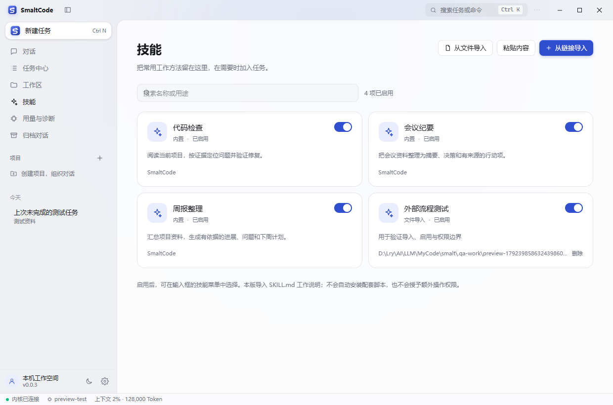
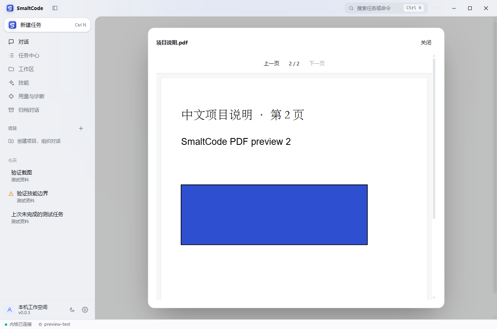
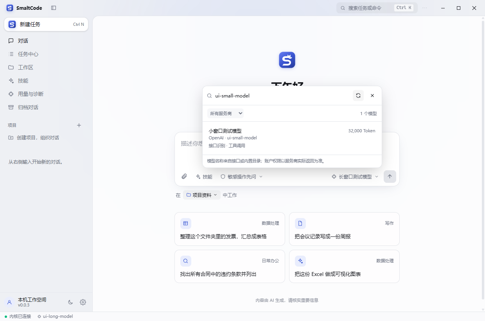

# SmaltCode 0.0.4：功能细节与本地验收

本文记录 **0.0.4 公开测试版** 的使用方式、功能范围和本地验证。[下载 Release](https://github.com/lryoooow/SmaltCode/releases/tag/v0.0.4)；GitHub Actions 保持关闭。下方独立开发预览用于隔离测试，也可直接安装 Release 使用。

## 启动独立开发预览

Windows 双击仓库根目录的 `打开开发预览.cmd`，或执行：

```bash
npm run preview:desktop
```

入口先构建源码，再打开带有“开发预览”标记的桌面窗口。需要已安装本仓库的 Node.js/npm 开发依赖。已构建时可直接执行 `node scripts/start-desktop-preview.mjs --no-build`。

预览配置、密钥、对话、技能和附件独立保存在仓库的 `.local-preview/data/`；此目录已加入 Git 忽略规则。**首次使用需自行配置模型**，不会复制正式版的密钥或对话。两者可以并存，预览也支持关闭窗口驻留托盘、托盘右键完全退出。

## 本批次完成内容

| 能力 | 使用入口与行为 |
| --- | --- |
| 技能库 | 侧栏“技能”，内置代码检查、会议纪要、周报整理；支持搜索、查看、启停和删除外部技能 |
| 外部技能导入 | 公开 HTTPS/GitHub 文件链接、本地 SKILL.md、粘贴文本；先预览来源与内容，确认后保持停用 |
| 为消息选择技能 | 输入框“技能”，只显示已启用项；每条消息最多选择 3 项，并显示引用标签 |
| 图片上下文 | 文件选择或粘贴 PNG/JPEG 截图，先预览再发送；以真实图片消息送给模型 |
| 资料预览 | PDF 原页绘制与翻页、DOCX 正文、XLSX 工作表和单元格；沿用文本文件多标签工作台 |
| 文档选段引用 | 任务右侧预览中点“选择文本”，选中提取文字后加入当前消息；提示模型分析或给出改写，不用文本补丁覆盖二进制原件 |
| 阅读位置 | PDF 页码、Excel 工作表及文件滚动位置按对话保留；切换页面或对话不停止后台任务 |
| 用量与诊断 | 侧栏集中查看已记录的输入/输出 Token、各对话用量、待恢复任务、本机运行文件与解析器状态 |
| 中断恢复 | 启动时识别未正常结束的任务，明确标记未保存的工具结果；用户检查后主动继续，不自动重放命令 |
| 执行验收 | 命令可使用独立程序与参数，保留真实退出码；检查发现、执行故障、跳过与结果冲突分别记录，重开后仍可查看 |
| 模型目录 | 设置与输入框共用搜索列表，支持筛选、刷新、接口容量、官方规格、手动覆盖及停用型号提示 |
| 诊断导出 | 通过保存对话框导出版本、运行文件状态与数量摘要，不包含正文、文件内容、服务地址和密钥 |





截图来自隔离测试配置和模拟模型服务。

## 外部内容的处理边界

导入器只保存 **SKILL.md 工作说明**。不会运行配套脚本、安装依赖或更改权限；引用 `scripts/`、`references/`、`assets/` 的技能会提示资源未随之导入。启用后，还需在输入框中明确选择，才会随消息发送给所选模型。

网络读取仅支持公开 HTTPS 443，不携带系统 Cookie 或认证信息。DNS 地址、每次重定向都重新校验，连接固定到已检查的地址；拒绝私网、本机及保留地址，最多 3 次重定向、64 KB、15 秒。导入预览 10 分钟后失效，确认保存的是已预览的同一份内容。

**当前网络验收限制：** 本机访问 `raw.githubusercontent.com` 时 DNS 返回保留地址，公开 GitHub 下载验收因此被阻止，未宣称真实外网导入通过。若代理使用 Fake-IP，切换到返回真实公网地址的 DNS 模式后再测；也可先下载 SKILL.md，通过“从文件导入”使用。不会为了下载而放开私网保护。下载与重定向的正常/异常行为已用可控网络测试覆盖。

Office 解压、XML、图片尺寸和文档文字都有上限；解析运行在受限工作线程，避免损坏文件卡住界面。不执行 Office 公式、宏、外部关系、PDF 表单或脚本。技能和文档内容按外部资料传给模型，继续沿用现有审批与工作区保护。**现有命令工具仍以用户身份运行，应用权限控制不等同于操作系统沙箱。**

## 当前支持范围

| 项目 | 范围 |
| --- | --- |
| 图片 | PNG/JPEG；单张 8 MB、4000 万像素；每条消息最多 4 张，需所选模型支持图片理解 |
| 文件 | 单个 15 MB；只读解析 PDF、DOCX、XLSX 和 UTF-8 文本，不包含旧版 DOC/XLS |
| Word | 正文与基础标题，不还原完整分页、复杂表格布局、批注或修订 |
| Excel | 已保存值与缓存公式结果；最多 10 表、每表前 1000 行/50 列，合计 30000 单元格/200000 字符；保留空白行位置 |
| PDF | 原页预览；文字提取最多 100 页/200000 字符；不含 OCR，加密文件需先解密 |
| 消息引用 | 每条消息最多 10 项；完整文档上下文取前 24000 字符，也可选段；超限明确提示 |
| 本地附件副本 | 持久保存用户明确添加的文件，256 MB/1000 项；本批次暂未提供容量清理界面 |
| 技能格式 | 常用 name/description frontmatter；正文 64 KB，单次选中正文合计 36000 字符；不支持整个插件包安装 |
| 用量 | 模型返回且已记录的累计 Token，包含归档对话，删除的对话不在统计内；不推算费用，压缩等未记录请求可能缺失 |

MCP 连接器、目标模式、定时任务、长期记忆和原生 Office 编辑仍属后续批次，没有用占位按钮冒充已完成。

## 执行可靠性与验证记录

只读审查可以正常结束并报告项目问题：`ruff format --check` 发现文件需要格式化属于检查发现；测试断言失败属于项目验证未通过；命令不存在、启动失败和超时属于执行故障。输出报告失败但外层命令返回 0，或检查被跳过时，显示“待验证”。原始输出与退出码保持可查。

测试和构建优先使用 `shell` 的 `program`、`args` 与工作区内 `cwd` 参数，避免拼接终端命令覆盖检查的退出码。Windows 批处理包装器只接受可安全引用的参数；复杂内联脚本应使用原生 Node/Python 程序。独立执行不会绕过既有权限、高风险检查与目录限制。

相同回合、相同范围的可靠复查可关联旧尝试；整套测试失败不会被单个用例通过清除。缺少终端搜索命令时，可关联已成功执行的原生搜索工具。权限拒绝、不同目录或不同检查范围不会由这些关联自动清除。无法可靠确认的复杂命令仍保留待验证状态。

模型准备结束时，系统检查未完成计划、可恢复的调用错误、冲突结果，以及代码改动缺少验证记录等情况，最多补充一次验收提醒。仍未验证的事项会如实保留；不会为了让检查变绿而修改只读审查中的文件，也不重复请求已拒绝的操作。该记录依据实际工具证据，不能代替所有业务场景的验收。

本地回归：402 项通过，3 项 CLI SEA 专用检查跳过；类型检查与构建通过。实际 Electron 界面使用隔离资料和模拟服务商，113 次推理请求及 5 次模型目录请求；技能/附件/文档验收另 7 次推理请求，均无渲染错误。检查结果分类、退出码冲突、跳过覆盖、重试关联、滚动切换和重开恢复均包含在验收中。

真实服务商评估独立于默认测试：`node scripts/eval-task-reliability.mjs --live [--provider NAME]` 仅发送合成样例，最多 8 次请求、每次 4096 输出 Token、180 秒。本次隔离环境未取得可用凭据，预检停止，未发送真实模型请求；不将模拟验收计为真实服务商兼容性通过。不要把密钥写入代码或提交到仓库。

本地安装包位于 `packages/desktop/release/SmaltCode-Setup-0.0.3-SFox.exe`，SHA256 见同目录 `SHA256SUMS.txt`。桌面构建直接打包当前内核源码，避免引用旧的内核编译目录；产物需通过图标、文件一致性、文档解析、启动及托盘退出重开检查。覆盖安装前先通过托盘退出旧版，安装与真实模型长任务由维护者继续验收。

## 统一任务进度与模型上下文容量

输入框上方只保留一个任务卡，显示实际运行的动作、程序或文件、已完成节点与计划入口。“思考与执行记录”只展示可展开的明细，不再重复转圈或展示另一组进度。计划在任务卡上方展开为非模态浮层；支持 Escape、点击外侧关闭、键盘滚动、长文本换行，浏览或切换对话不会停止任务。历史回合只保留最终计划快照，独立于执行记录；停止或失败时保留实际完成比例，不伪装成全部完成。新日志持久化计划 ID，旧日志用回合与事件序号生成稳定 ID，避免同毫秒更新相互覆盖。

旧逻辑将不同型号统一套用服务商的 128K 默认容量，叠加系统与工具开销后导致长窗口模型约 100K 就整理。0.0.3 按确切端点和型号解析预算；DeepSeek V4 Pro 的 1M 容量依据：[官方模型说明](https://api-docs.deepseek.com/quick_start/pricing/)。

- 官方 DeepSeek V4 Pro / Flash 按具体模型解析为 1000000 Token，默认约 800000 Token 时整理；不会在 10K、100K 或 256K 时主动压缩。官方规格只应用于确切官方端点和已确认的模型名。
- 第三方网关先读取自身接口报告的容量，不根据名称套用原厂规格。未知模型保留保守默认值，可在“设置 → 模型服务商 → 上下文窗口”填写每个模型的实际容量。每个模型的手动设置优先于服务商设置；“恢复自动容量”清除当前模型及服务商统一覆盖，保留其他模型的单独设置。小窗口模型仍按自身容量保留输出空间。
- 执行、重新读取对话和状态栏使用同一容量解析。运行中的任务沿用启动时配置，下轮才采用新配置；新增测试覆盖运行中更改设置。
- 摘要失败后，输入未明显增长且仍有空间时不重复整理。无有效减量的摘要不视作成功；空间即将耗尽时允许重试，仍保留原始指令、工具配对和近期工作记录。
- 状态栏显示容量、当前估算与整理阈值；右侧“统计”区分累计用量和当前上下文，记录整理前后用量、触发时总输入及窗口/阈值。新触发诊断包含系统与工具说明开销，旧日志没有的字段保持缺省。

本地自动测试覆盖 1M 模型下约 100K 的实际历史继续执行且不发摘要请求、未知端点回退、手动容量与恢复自动设置、提前整理失败重试间隔、真实空间不足、计划历史恢复和实际桌面布局。仍需维护者用真实服务商验证长任务；本轮外部模型请求数为 0。

## 模型目录与容量自动识别

桌面端在启动、保存连接与下一轮任务准备时读取已配置服务的模型元数据；无需复制型号到官网核对。设置面板与输入框共用可搜索列表，支持服务商筛选、手动刷新、自定义 ID、工具调用/图片能力提示。目录刷新不会覆盖当前已选模型，任务运行中保留已启动的预算；切换对话继续运行。

| 服务 | 目录与容量来源 | 说明 |
| --- | --- | --- |
| OpenAI | 官方 `/v1/models` 型号；确切官方型号的规格快照，或所选公开型号的官方模型卡 | 列表通常不返回窗口；模型卡请求不携带密钥，不访问私有微调 ID。已知当前工具协议未适配的型号说明原因并禁选 |
| Anthropic | `/v1/models` 分页、名称、最大输入与输出及生命周期 | 没有元数据时使用确切官方型号快照；不会把输出上限当成窗口 |
| DeepSeek | `/models` 的窗口与最大输出，保留官方 V4 规格后备 | Chat 与 Anthropic 连接使用同一正确的 Bearer 元数据路线 |
| 智谱 | 兼容 `/models`；接口不支持时读取官方模型目录 | 按 GLM 具体型号处理，区分 128K、200K、1M；官方目录不证明账户已开通 |
| Kimi | 兼容 `/models`；接口不支持时读取官方型号与下线目录 | 新型号可从目录发现；原有自定义 ID 不被删除，已下线型号会提示 |
| 通义千问 | 兼容 `/models`；接口不支持时读取官方目录表格 | 区分窗口列与输出列；服务区域和所用路由可能有不同限制 |
| OpenRouter | `/api/v1/models/user` 当前账户筛选目录 | 合并顶层及路由限制时使用较小值，读取能力与输入模态，不套用原厂窗口 |
| Ollama | `/api/tags` 型号、`/api/ps` 当前分配、所选型号 `/api/show` 显式 `num_ctx` | 不把 GGUF 理论最大窗口当成已分配窗口；未加载且无显式配置时仍需确认 |

容量优先级为：**每模型手动覆盖 → 服务商手动覆盖 → 接口元数据/确切官方规格 → 标记待确认的后备值**。同时报告总窗口与最大输入时，采用较小值。未知兼容服务后备 128K、未知 Anthropic 连接 200K、未确认分配的本机 Ollama 4K，均不宣称为已测得的实际容量；用户可按自己的网关/本地服务配置修正。更小的实际服务限制也可能因账户或路由而变化，不能仅凭模型名称保证可用。

元数据缓存按端点、协议和凭据摘要隔离，刷新间隔 6 小时，断网最多保留 7 天缓存并标注；短期失败退避 60 秒，支持主动刷新。刷新不发送对话正文、不发推理请求，失败不阻止使用现有配置。官方公共目录仅在列表接口明确不支持时使用；不会用它掩盖 401/403 认证失败。容量来源及刷新时间在设置中可查，未知值保留手动入口。命令行继续使用共享规格与本地缓存；自动网络发现由桌面宿主启用。

截至 2026-10-19，本机实际读取智谱、Kimi、通义的公开目录，分别解析出 23、17、36 项记录；包含下线或不支持工具的记录。它验证了公开目录格式，不代表这些型号均可通过当前账户调用。自动测试覆盖新名称、容量更新、缓存过期/断网、分页、凭据隔离、目录列解析、Ollama 实际分配、100K 同一历史在 1M/32K 模型间切换及刷新不覆盖已选型号。本轮真实推理调用数为 0。

官方依据（2026-10-19 核对）：[OpenAI 型号](https://developers.openai.com/api/docs/models)、[Anthropic Models API](https://platform.claude.com/docs/en/api/models/list)、[DeepSeek Models API](https://api-docs.deepseek.com/zh-cn/api/list-models/)、[智谱模型概览](https://docs.bigmodel.cn/cn/guide/start/model-overview)、[Kimi 模型目录](https://platform.kimi.com/docs/models)、[通义模型目录](https://www.alibabacloud.com/help/en/model-studio/text-generation-model/)、[OpenRouter 账户目录](https://openrouter.ai/docs/api/api-reference/models/list-models-filtered-by-user-provider-preferences-privacy-settings-and-guardrails)、[Ollama 当前分配](https://docs.ollama.com/api/ps)。



## 建议维护者手工验收

1. 新建测试文件夹与预览模型配置，分别测试文字、带图消息和真实服务商的图片兼容性。
2. 导入自己的 SKILL.md，核对来源、正文、默认停用、启停、选择发送、删除及重启持久化。
3. 在正常公网 DNS 下测试 GitHub 原始文件、重定向、断网和超时；也测试本机/私网链接会被拒绝。
4. 添加中文 PDF、Word、带空行的 Excel 与截图；切换文件、页码、工作表及对话，核对内容与阅读位置。
5. 引用一小段文档，要求总结或改写；检查原件、模型实际回复与引用范围。
6. 长任务运行时上翻历史、进入技能库/用量页、切换其他对话、隐藏到托盘，确认任务继续且页面不被抢回。
7. 在专用测试任务中模拟异常结束后重开，检查恢复提示；先检查执行结果，再手动继续，避免重复副作用。
8. 保存自己的服务连接，获取并搜索型号，切换长/短窗口，核对容量来源；断网刷新后检查缓存提示。手动设置一次容量，再恢复自动，核对其他模型覆盖未丢失。

## 本地自动验证

2026-10-19 发布验收已执行（见 [0.0.3 版本验收记录](releases/v0.0.3-verification.json)）：

| 检查 | 结果 |
| --- | --- |
| `npm run typecheck` / `npm run build` | 通过；源码构建与本地测试包构建分别执行 |
| `npm test` | 402 项通过，3 项需要 CLI 打包 EXE 的测试跳过 |
| `scripts/test-desktop-ui.py` | 113 次模拟推理与 5 次目录请求通过，覆盖模型搜索/刷新/断网缓存/选择保留、单一任务卡、计划浮层、历史计划、容量设置、整理诊断、审批、项目、选段修改、滚动、多对话、64 步任务和后台驻留；渲染错误 0 |
| `scripts/test-desktop-preview.py` | 7 次模拟请求通过；中文 PDF 像素实际绘制、Word 转义内容、Excel 切表、图片消息、外部技能权限、恢复、脱敏与后台浏览；渲染错误 0 |
| `scripts/test-desktop-tray.mjs` | 同一隔离配置连续 3 轮关闭、恢复、退出、重开通过；259 个运行文件保持不变 |

新增单元测试包含不可信页面/子框架 IPC 拒绝、导入预览令牌校验、私网/保留地址、混合 DNS、固定连接地址、重定向换址、超时、流量超限、无效 UTF-8、技能内容变化、附件摘要变化、路径穿越、恶意 XML、解压膨胀、共享字符串放大、图片尺寸、异常解析线程和未完成工具恢复。

测试使用本地模拟模型，不代表已验证所有外部模型。`npm audit --omit=dev` 本次报告 0 项；包含开发依赖的审计仍有 15 项（构建/测试工具链），升级需另行兼容验证，不将其描述为“全项目零风险”。

打包程序的界面验收通过仅监听本机的主进程调试连接处理系统确认框，限定隔离测试进程与已知弹窗标题；应用中的授权确认与权限规则保持不变。授权同意/拒绝及不可信页面分支另由 IPC 单元测试覆盖。这不等同于对 Windows 系统弹窗本身进行人工验收。

复跑新界面验收需要 Python 的 Playwright 与 reportlab（在自己的虚拟环境安装）；`--network` 参数额外要求公开 GitHub 下载成功，不会将网络失败记为通过。所有验证都在本机执行。


## 2026-10-20 · 0.0.4 可靠性更新

本节对应 0.0.4 公开测试版；[发布说明](releases/v0.0.4.md) 与 [版本验收记录](releases/v0.0.4-verification.json) 提供更新和安装包检查结果。GitHub Actions 保持关闭，上文 0.0.3 发布验收作为历史保留。

- 项目数据：逐项验证和隔离坏记录；损坏主文件可读取上一份有效备份。读取时不覆盖原件，实际修复写入前保存带随机编号的损坏副本；不可读或被其他进程改动时停止写入。项目异常通过界面提示，不能再使整个桌面断开。备份可能早于最后一次编辑，仍需检查恢复后的项目说明。
- 工具参数：递归校验数组元素、嵌套必填项、枚举、整数及边界，限制深度、总文本与节点数；错误指出具体字段。计划最多 200 步，问题选项最多 30 项；保留显式自定义字段兼容。Hook 改写后的错误输入也会阻止执行。
- 模型能力：按具体型号检查显式图片/工具能力和下线状态，包含历史图片；准备上下文前及实际请求前均校验，明确不兼容时不会发送该次推理。未知能力保持兼容，不根据名称猜测；真实服务仍可能返回自身限制。
- 大历史：会话元数据使用按文件大小、时间与文件标识校验的派生索引；损坏或过期可自动重建。旧日志按完整 UTF-8 行从尾部有界扫描，忽略过大的正文行；已完成任务不再在启动时全量重放，旧用量也支持尾部读取。原始 JSONL 仍是对话记录。
- 界面：批量初始化对话元数据；默认展示最近 60 条时间线记录，展开执行详情先展示最近 80 项，可继续查看更早记录。加载时保留阅读锚点，切换对话保留已展开范围；完整记录与模型上下文不受展示分页影响。超长回复流式输出时暂用纯文本，结束后恢复 Markdown。

0.0.4 本地检查：类型检查与源码构建通过；**422 项测试通过、3 项 CLI SEA 专用检查跳过**。实际打包 Electron 桌面 **113 次模拟推理及 5 次目录请求**，文档/技能另 **7 次模拟推理**，渲染错误均为 0。桌面新增损坏项目启动、保留原件、2000 条历史消息与 500 项执行记录的分页、阅读锚点、切换恢复及深浅/窄窗口验收。正常渲染与空白渲染故障探针通过，连续三轮托盘隐藏/恢复/退出/重开通过，打包产物的 259 个运行文件保持不变。

合成性能探针为 100 段、约 50 MB 历史：本机一次测量，原全日志列表读取约 214 ms，新索引列表与启动恢复探针合计约 40 ms，重复列表平均约 1.8 ms。文件系统缓存已预热，该结果仅用于本地对比，不代表所有机器的速度。验证不使用正式对话或真实付费推理。

测试入口仍为仓库根目录的 `打开开发预览.cmd` 或 `npm run preview:desktop`；使用独立的 .local-preview/data 配置。

0.0.4 安装包：`packages/desktop/release/SmaltCode-Setup-0.0.4-SFox.exe`，安装前通过托盘完全退出旧版；不需要清空现有配置和对话。桌面验收可复跑 `python scripts/test-desktop-ui.py --packaged --resilience`。
