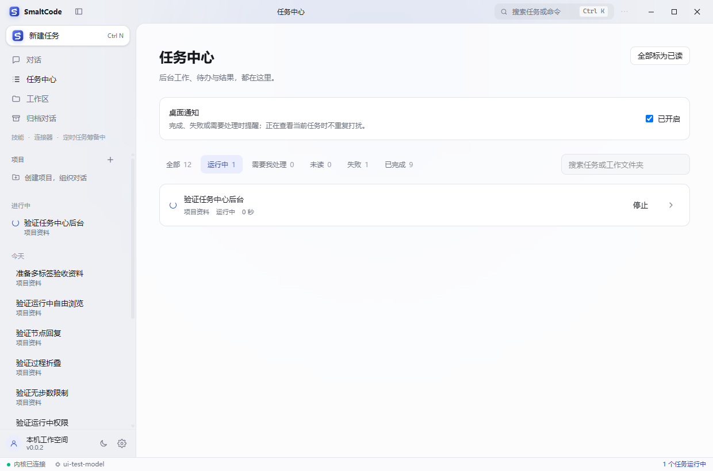
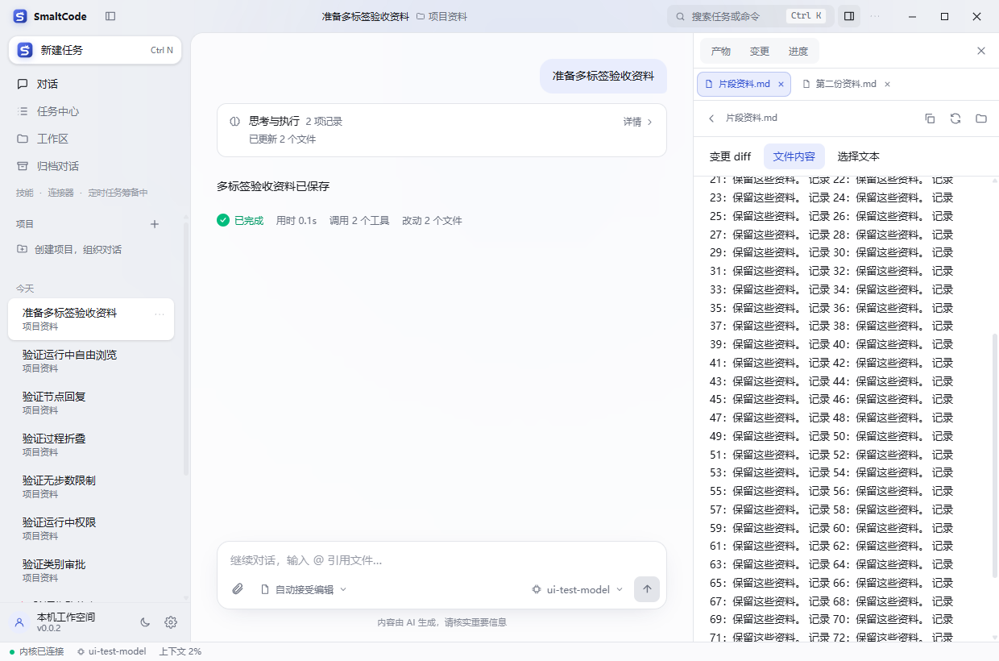

# SmaltCode 0.0.2 · 公开测试版

发布于 2026-10-15。本轮集中完善任务处理和文件编辑体验，启用统一的 S Fox 狐狸 Logo。应用与安装包版本为 0.0.2，仍是公开测试版，欢迎踊跃试用、报告问题和提出建议。

[下载当前安装包与查看 Release](https://github.com/lryoooow/SmaltCode/releases/tag/v0.0.2) · [本次更新概览](v0.0.2-release-notes.md)

## 四项新增能力

| 能力 | 使用方式 |
| --- | --- |
| 任务中心与桌面通知 | 左侧打开“任务中心”，筛选运行中、需要处理、未读、失败和已完成任务，搜索任务或工作文件夹；可停止任务、全部标为已读，或返回需要审批的对话。 |
| 多标签预览与文本选区修改 | 右侧打开多个产物文件，分别切换、关闭和刷新标签。点击“选择文本”，选中片段后加入对话，填写修改要求并发送。 |
| @ 文件引用 | 在输入框输入 @ 和文件名，用上下键与 Enter 选择工作区文件。引用可移除，Enter 选择资料不会提前发送消息；各对话的引用草稿相互独立。 |
| 变更审查与检查点恢复 | 右侧“变更”中审查实际文件差异，撤销某个文件，或恢复某次操作前的文件。恢复前核对冲突并确认，保留原有对话。 |

## 品牌更新

采用狐狸轮廓与字母 S 融合的 S Fox 标志，SmaltCode 字标提供浅色和深色版本。窗口、界面、托盘、EXE 与安装程序均由同一矢量母版生成；品牌资源与小尺寸展示见 [品牌说明](../brand/README.md)。

## 界面与交互

- 延续统一的浅色、深色主题、间距、圆角和中文状态文案。
- 运行中可上翻历史、浏览文件、切换标签和切换对话；新输出和任务结束不会强制拉回底部。
- 文件标签、缓存与阅读位置在当前应用会话内按对话独立记住，重新启动后可再次打开文件。
- 后台文件有新变更时显示刷新提示，保留当前阅读内容；选区发送前重新读取文件并校验摘要，过期选区会要求重新选择。
- 对话显示原始提问和简洁的引用标记，内部资料、摘要值和选区修改约束供模型使用，避免长数据撑坏聊天布局。
- 审批、失败和需要回答的状态保持可见；正在查看并聚焦当前对话时不重复弹出通知。
- 通知延迟合并，已处理请求会取消提醒；点击通知才恢复窗口并定位对话。关闭通知会清理待发和已显示的提醒。
- 关闭窗口仍隐藏到托盘；右键“退出 SmaltCode”才完全退出。

## 引用和恢复范围

文件预览与引用支持工作区内不超过 512 KB 的 UTF-8 文本。每次最多引用 10 项，整文件每项最多取前 24000 字符，超过时在引用标记中说明；选区按原文读取，总引用内容不超过 64000 字符。二进制文件、工作区外路径、敏感配置以及越界链接不会作为引用发送。引用资料会进入你配置的模型服务请求。

选区修改通过正常模型和工具执行流程完成，遵守当前权限设置。它提供精确片段和修改范围要求，实际修改仍应通过差异审查确认。

检查点记录本版本之后通过 write / apply_patch 完成的文件操作，按单次操作保存，而非整轮任务的完整环境快照。每次最多 64 个文件，单文件最大 2 MB，修改前备份的 Base64 内容合计最多 16 MB。超限会拒绝该次受保护编辑并返回可处理的错误。终端命令、Git 状态、数据库、网络请求和外部系统副作用不在文件恢复范围。

恢复前必须停止同一工作区及重叠工作区中的运行任务。文件被手动或后续操作修改时，冲突项不会被覆盖；可以只恢复其他无冲突文件。新建文件恢复后移除，删除文件恢复后重建。恢复记录告知模型重新读取文件，删除对话也清理对应的检查点备份。工作文件夹中的真实文件不会随对话删除。

## 本地构建

    npm ci
    npm run typecheck
    npm test -- --maxWorkers=1 --no-file-parallelism
    npm run build
    npm run package:desktop
    python scripts/test-desktop-ui.py --packaged

Windows x64 安装包生成于 packages/desktop/release/SmaltCode-Setup-0.0.2-SFox.exe。安装包未签名，通过 Release 手动下载安装；同页提供 SHA256SUMS.txt。构建输出只保留当前安装包与校验文件，旧安装包、重复副本和过期打包目录已清理。0.0.1 保留版本与功能历史，旧安装附件下架。

## 验收

已通过类型检查、24 个文件共 202 项自动化测试，以及实际打包程序的完整界面回归：105 次模型请求，零渲染错误。图标与 PE 版本、启动、托盘隐藏/恢复/退出检查均通过，打包资源与已检查的构建文件完全一致。浅色、深色及 920 像素较窄窗口布局均已检查实际截图。最终记录见 [v0.0.2-verification.json](v0.0.2-verification.json)。模型服务为本地模拟服务，文件、IPC、内核和 Electron 均实际运行；不代表所有第三方模型均已验证。

Windows 系统通知的去重、取消、偏好、窗口恢复与点击定位通过模拟 Electron Notification 的自动化测试。端到端验收模式记录通知事件以避免弹出大量系统提醒，未验证此电脑通知中心设置或专注助手对横幅的影响。

## 实际界面

截图来自实际打包程序的验收场景，采用本地模拟模型与临时测试资料。
