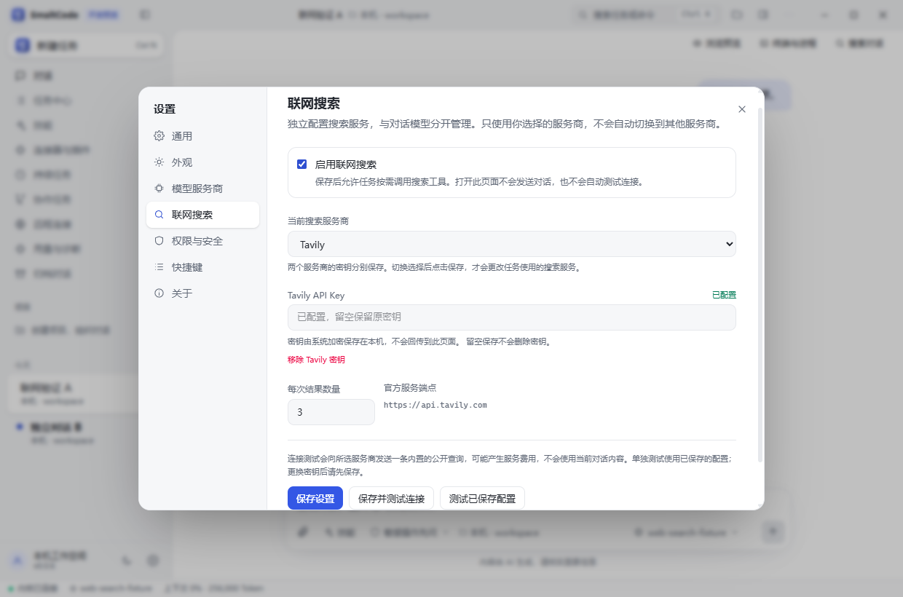

# SmaltCode v0.0.6 · 联网搜索与 Windows 图标修复 · 公开测试版

本次加入 Tavily / DeepSeek 联网搜索与网页读取，修复 Windows 任务栏仍显示 Electron 图标，以及重启后出现空白图标的问题，完善品牌运行时、窗口身份、快捷方式与测试隔离。**0.0.6 仍是公开测试版**，欢迎报告 Bug、提供脱敏复现步骤并提出改进建议。工作区、SSH、Office 等功能沿用 [0.0.5](v0.0.5.md)，不重复列为本版新增。

## 联网搜索与网页读取



- 新增 **设置 → 联网搜索**，可选择 Tavily 或 DeepSeek，分别管理 API Key，配置开关与每次 1–10 项搜索结果。联网配置与对话模型分开；不会自动使用模型密钥，也不会失败后改用另一家服务。
- 支持 `web_search` 搜索与 `web_fetch` 读取公开网页，返回标题、链接及摘要/网页内容。网页作为外部资料处理，不能代替用户授权或修改任务指令；私有网络与带凭据地址受校验限制。
- 回复中的公开 HTTPS 来源可点击进入原对话的隔离浏览侧栏，保留独立复制按钮。首次访问经过原生站点确认，网页没有 Node.js 或应用桥权限；HTTP、带凭据等不能直接预览的链接会明确提示复制，不放宽现有浏览安全边界。
- 普通对话与 SSH / 容器对话可使用独立的主机端搜索服务。服务不直接获得文件或执行工具权限，仅接收模型提交的检索词或指定 URL，不自动附加项目文件或完整对话；请避免在检索词中包含私有资料。托管、定时或其他无人值守任务仍服从各自工具白名单；全局启用搜索不会自动扩大任务范围。
- 密钥通过系统加密保存；加密不可用时仅本次运行有效。页面只显示“已配置”，不会读回原始密钥；留空保留密钥，移除需要独立确认。
- 保存后可测试连接；测试仅发送内置公开查询，提前提示可能产生费用，可取消、切换服务商或关闭设置。认证、余额/额度和请求频率问题分别提示，迟到响应不覆盖离开的页面。

使用时先选择服务商并填写密钥，点击 **保存并测试连接**；确认结果后开启并保存。两个服务商的密钥独立保留，任务只使用保存后的当前选择。打开设置不会自动测试或发送对话。

搜索和网页读取可能消耗服务商额度或产生费用，测试也可能计费；套餐、价格与活动会变化，以 [Tavily 官方额度与计费](https://docs.tavily.com/documentation/api-credits) 和 [DeepSeek Search & Fetch 官方说明](https://api-docs.deepseek.com/guides/search/) 为准。

## 本次修复

- **独立品牌预览运行时。** Windows 开发预览不再直接使用共享的 `electron.exe`。启动时复制完整运行时，生成 `SmaltCode Preview.exe`，嵌入 S Fox 图标、产品名称和当前桌面版本，保留源码入口所需资源。原始 Electron 文件不作修改。
- **真实图标路径与统一重启身份。** 安装版和品牌预览把真实 EXE 路径交给 Windows Shell。主窗口、文档审阅窗统一应用身份、重启名称与命令；审阅窗的任务栏入口重新打开主应用。Shell 图标路径不指向 ASAR 内的虚拟文件。
- **专用预览快捷方式。** 使用“SmaltCode 开发预览”入口，并校验目标、参数、图标和应用身份。旧 `Electron.lnk` 只有在目标、仓库参数和预览身份均严格匹配时才迁移，迁移前备份原始文件；其他软件或无法确认归属的快捷方式保留。
- **GUI 测试身份隔离。** 自动化桌面测试使用独立 `.test` 身份，避免测试过程重新生成与正常预览同身份的旧 Electron 快捷方式。增加脚本契约检查，防止后续测试启动器遗漏隔离标记。
- **预览配置隔离。** 快捷方式或窗口重启继续使用 `.local-preview/data/`。无法确认源码目录、或错误地以 ASAR 启动开发预览且未指定资料位置时，拒绝启动，避免回落到正式版资料。

这次修复以实际运行入口和 Windows Shell 身份为依据。没有将问题归因于 ICO 文件损坏，也不会清空或重建任意 Windows 图标缓存。

## 安装与使用

下载 `SmaltCode-Setup-0.0.6-SFox.exe`，按 Release 附带的 `SHA256SUMS.txt` 校验。升级前从系统托盘右键选择 **退出 SmaltCode**，完全退出旧版，再运行安装程序。安装完成后从 **SmaltCode** 桌面或开始菜单入口启动。

关闭主窗口仍会驻留托盘；右键托盘 **退出 SmaltCode** 才完全退出。安装包尚未进行代码签名，Windows 可能提示未验证发布者。

源码开发使用：

```bash
npm run preview:desktop
```

Windows 品牌运行时缓存位于 `.local-preview/runtime/`，按 Electron 版本、产品版本和图标摘要区分。复用前校验文件和品牌 EXE；损坏缓存会报错，不在运行中覆盖。预览资料与正式安装版分别保存。

## 验证记录

所有验证在本地执行，**GitHub Actions 保持关闭**。完整验收摘要见 [验证记录](v0.0.6-verification.json)。

| 检查 | 结果 |
| --- | --- |
| 核心回归 | 85 个测试文件、1027 项通过，0 失败；3 项 CLI SEA 夹具检查跳过 |
| 类型与恢复 | 完整类型检查、独立恢复复现回归通过 |
| 新增联网能力 | 55 项后端、30 项来源链接检查包含在核心回归中；另有 12 组完整 GUI 场景通过，并追加 6 组受影响界面回归 |
| 原有桌面能力 | 完整基线 26 组桌面、4 组原生回归通过；来源焦点修复后另有 6 组受影响界面检查通过 |
| 品牌入口与启动 | 30 次基线品牌关联检查通过；自有预览入口缺参数修复后，经原生读取和 Windows Shell 重开验证，旧入口已备份、备用入口未改 |
| 密钥与会话隔离 | 双服务独立密钥、错误脱敏、请求撤销、来源隔离浏览、A/B 对话与持久历史隔离通过 |
| 真实任务栏 | 维护者已在真实桌面确认当前开发预览的运行中图标正确显示 SmaltCode |
| 安装包 | 307 个构建文件一致、246 个解包工作资源齐全；图标/版本、解析、主窗与审阅窗身份通过 |
| 打包运行时 | 真实 SSH 加密私钥、PTY 输入授权与退出清理、DOCX/XLSX/PPTX 引擎保存链通过 |
| 实际安装载荷 | NSIS EXE 提取的 319 个文件逐字节一致；解析、启动和三轮托盘退出再次通过，未替换现有安装 |

两家官方搜索接口在不提供密钥时均返回预期 HTTP 401，证明端点可达。成功查询、网页读取和故障回归使用本地 HTTP 夹具及合成密钥；**没有使用真实付费账户查询**。请在软件中填写自己的 Key 并测试，以确认账户权限、余额和可用性。

来源新标签选中与请求消费修复后，重新执行了完整核心回归和受影响界面检查，最终源码摘要一致。既有浏览预览回归曾出现一次间歇超时，保留失败证据后，受控诊断及正式串行复验通过；未据此声称已找到或修复该超时的根因。原始复现、失败记录与本地测试资料保留在维护者工作区，不随发行上传。

```text
SHA256  2b0e8edaf2b1fb08c7e58d31db8ec0dcfba992a3d3da308df2457e4dea8da800
File    SmaltCode-Setup-0.0.6-SFox.exe
```

欢迎在 [Issues](https://github.com/lryoooow/SmaltCode/issues) 提交版本、启动方式、复现步骤和脱敏截图；请勿附带密码、密钥或私有工作资料。
