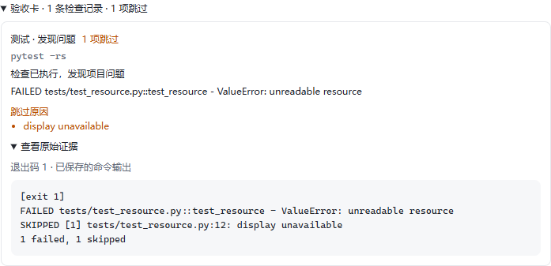
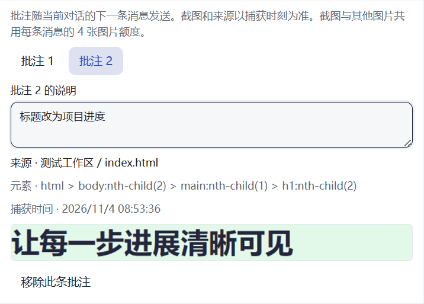

# SmaltCode v0.0.7 · 验收卡、网页批注与安全恢复

**Windows x64 公开测试版。** 欢迎体验并通过 [GitHub Issues](https://github.com/lryoooow/SmaltCode/issues) 提交可复现的问题和建议。反馈可附上版本号、操作步骤、预期和实际结果，以及脱敏后的截图或日志。

## 本次更新

### 可追溯的验收卡

- 在本轮执行结果中按需展开验收卡，查看测试、类型检查、构建等检查的结论、失败原因和跳过原因。
- 展开单条证据可核对退出码、已保存的原始命令输出，以及后续复查记录。原始输出缺少跳过原因时会明确提示。

### 网页多点批注

- 在隔离浏览侧栏点击 **多点批注**，连续选取多个元素并逐条填写说明。悬停时按 **↑ / ↓** 切换父子元素，按 **Esc** 结束点选。
- 打开 **核对批注** 可检查编号、元素、来源与捕获时的截图，也可移除单条。确认后随当前消息发送。
- 修复高 DPI 显示器上的批注截图裁剪偏移，新增像素回归检查。

### 恢复前预览与逐项结果

- 在右侧 **变更 → 预览本次恢复** 查看将恢复、有冲突、无恢复记录和已恢复的文件。可逐项打开差异，核对当前内容与检查点中的目标内容。
- 写入前逐文件重新核对。预览后有新修改、原目录已删除等情况会保留现状并报告冲突。已知但未捕获快照的文件会标明无恢复记录。
- 恢复结束后显示逐文件结果与原因。原对话保留最近一次恢复的时间和结果，重新打开后可回查。后台任务运行时仍可浏览和切换对话，同一工作区写入会与恢复互斥。

### 平台适配

- macOS 源码加入原生窗口按钮、系统菜单、快捷键、后台驻留和品牌资源，补齐本地预览与发行构建流程。
- 远程 HTTPS 证书改为后台生成，移除对 PowerShell 或 OpenSSL 命令的依赖。macOS Office 提供只读的应用包检查。
- 本次下载提供 Windows x64 安装包。macOS 安装包仍待 Developer ID 签名、Apple 公证和原生实机验收。

## 安装与校验

下载 **SmaltCode-Setup-0.0.7-SFox.exe**。可使用 **SHA256SUMS.txt** 校验安装包。Windows 包未做代码签名，系统可能显示未验证发布者。

## 发布验证

- 本地自动测试 1,027 项通过，0 项失败，48 项依赖特定环境或其他构建产物的用例跳过。Windows 安装包通过版本和图标校验、启动检查与三轮托盘退出回归。
- 安装包解包后，320 个运行文件逐一通过 SHA-256 比对。提取出的实际应用通过 33 项桌面交互检查，网页与对象反馈专项通过 10 项。
- GitHub Actions 保持关闭。本次验证在本地 Windows 完成。

[查看 v0.0.6 至 v0.0.7 的源码差异](https://github.com/lryoooow/SmaltCode/compare/v0.0.6...v0.0.7)
